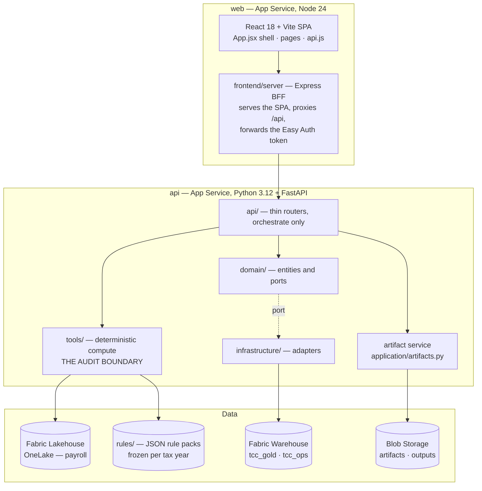

# Tax Credit Copilot

Continuous eligibility, discovery and audit-defensible calculation for US
job-creation tax credits, computed directly from payroll.

> **Prototype software. Not tax advice.** Read [DISCLAIMER.md](DISCLAIMER.md)
> before using any output to support a filing, and [SECURITY.md](SECURITY.md)
> before deploying it anywhere near real data.

---

## The problem

Job-creation credits are calculated retrospectively, from spreadsheets and Access
databases, once a year. Companies underclaim, miscalculate, or skip them
entirely — not because the credits are unavailable, but because payroll is
complicated and the audit risk of getting it wrong is worse than the money.

This system reads payroll continuously and answers three questions a spreadsheet
cannot: **what do you qualify for now**, **what would change that**, and **prove
it**.

## The governing constraint

Every number this produces can land on a filed tax return. That single fact
drives the whole design:

- **Agents narrate. Tools calculate.** No figure is ever produced by a language
  model. Deterministic Python computes; an agent may explain the result and
  nothing else. See [ADR-004](docs/architecture/ADR-004-agentic-workflows.md).
- **Rules are frozen per tax year.** Georgia's minimum weekly wage was $541 in
  2020 and $636 in 2023. A retroactive audit prices each year under the statute
  in force *that* year, so a historical run replays exactly. A year with no
  authored rule pack is **declined by name**, never estimated from a neighbour.
  See [ADR-005](docs/architecture/ADR-005-year-versioned-rules.md).
- **Every figure carries its derivation.** Each calculation records
  `{step, inputs, formula, output, citation}` and a SHA-256 over the trail, so
  any number on screen can be walked back to the rows and the rule that produced
  it.

## The parity gate

The reference dataset must always produce:

| | |
| --- | --- |
| Employees evaluated | **10,236** |
| Eligible — Min-Max method | **539** |
| Eligible — Pay Period method | **656** |

These are reconciled against a partner's independent methodology. They are
defined once, in `backend/tests/certified.py`, and are **never edited to make a
test pass**. A change that moves them is either a real improvement that requires
re-reconciliation, or a bug.

```pwsh
cd backend ; $env:TCC_REQUIRE_PARITY=1 ; pytest tests/ -q
python backend/tools/verify_reference_independent.py
```

The second command re-derives those figures through a separate implementation
that shares no code with the engine. Two implementations agreeing is worth more
than one passing its own tests.

---

## Running it

**Prerequisites:** Python 3.12+ and Node 24 LTS (CI and App Service run exactly
these). For the Fabric data source, the Azure CLI (`az`) with access to the
lakehouse. To deploy, also the Azure Developer CLI (`azd`) and Terraform
(`>= 1.9`; CI pins 1.16.5).

```pwsh
# Backend
cd backend
python -m venv .venv ; .\.venv\Scripts\Activate.ps1
pip install -r requirements.txt
copy .env.example .env          # then edit — see "Data sources" below
python -m uvicorn main:app --port 8000

# Frontend, in a second terminal
cd frontend
npm install --legacy-peer-deps  # see "Known quirks"
npm run dev                     # http://localhost:5173
```

To serve a production build the way App Service does (Node 24, same-origin
`/api` proxy, Easy Auth token forwarding), run `npm run build` then
`API_BASE_URL=http://127.0.0.1:8000 npm start` (port 8080, `/healthz`). The
Dockerfiles and `nginx.conf` are optional, for local containers only.

The application is at `/`. First load builds the calculation workspace,
which takes 60–75 seconds against local data and longer on a cold Fabric read.

### Data sources

Set `DATA_SOURCE` in `backend/.env`. The choice matters more than it looks:

| Value | What it reads | Scope |
| --- | --- | --- |
| **`lakehouse`** *(default)* | **Microsoft Fabric lakehouse, `SOURCE_SCHEMA` schema** (default `tcc_source`; a customer overlay sets this to its own schema name) | **Five accounts, 564,931 rows, TY2020–TY2026. The partner's real source shape, and the only one the product ships against.** `flex` is accepted as a deprecated alias |
| `fabric` | Fabric lakehouse, flattened `dbo/employees` table | One tenant, 9,477 rows, no account column. An early slice, kept only because ingestion tests exercise the flattened mapping |
| `csv` | Local file | **A test fixture, not a data source.** `tests/conftest.py` selects it so the suite runs offline; it is not deployable |

Pointing at the wrong source **does not raise**. The application starts, one
client resolves, and every portfolio view is merely thin. `backend/.env.example`
documents all three with their row counts.

`backend/tests/test_fabric_source_selection.py` pins the distinction. Run it
with `TCC_FABRIC_TESTS=1`; it skips cleanly otherwise.

### Deploying

`azd` over Terraform. `TCC_PROFILE` picks the profile: `public` (the default)
creates everything, including an F2 Fabric capacity, workspace, Lakehouse and
Warehouse, and loads the synthetic dataset; `enterprise` brings its own
network and Fabric (`infra/profiles/enterprise.tfvars.example`).

```pwsh
az login ; azd auth login
azd env new <name> --no-prompt
azd env set AZURE_LOCATION <region>
azd env set AZURE_RESOURCE_GROUP <resource-group>
azd env set TCC_PROFILE public
azd env set FABRIC_CAPACITY_ADMIN (az ad signed-in-user show --query userPrincipalName -o tsv)
azd env set GIT_COMMIT (git rev-parse HEAD)   # stamps every run with the commit
azd up --no-prompt
```

`azd up` provisions with Terraform, packages and deploys both App Service
apps, then runs `scripts/postprovision.ps1`: Warehouse migrations, the
synthetic load (public only), T-SQL grants and seed. Terraform never registers
resource providers — register them first. Re-running is idempotent:
`terraform plan` shows no changes and `apply-migrations.py` reports 0 pending.
`azd down --purge --force --no-prompt` tears it down, Foundry soft-delete included.

[DEPLOYMENT-HANDOVER.md](docs/architecture/DEPLOYMENT-HANDOVER.md) is the
full procedure, including the Fabric grants Terraform cannot express.

---

## Architecture

Three layers, and one invariant that separates them.



**The invariant: agents never compute and never see tools.** Every number is
produced by pure Python in `tools/`, captured into a calculation trail, and
handed to an agent as a JSON brief it can only narrate.

Generated files — the claim package XLSX (`application/claim_package.py`) and
rule-pack source documents — live in Blob Storage behind the artifact service.
The browser never receives a SAS; every download is audited in
`tcc_ops.artifact_access`.

The infrastructure is described in
[INFRASTRUCTURE-COMPONENT-SPEC.md](docs/architecture/INFRASTRUCTURE-COMPONENT-SPEC.md),
[CONNECTIVITY-MATRIX.md](docs/architecture/CONNECTIVITY-MATRIX.md),
[ENV-VARS.md](docs/architecture/ENV-VARS.md),
[RUNBOOK.md](docs/architecture/RUNBOOK.md) and
[FLOW-v2.md](docs/architecture/FLOW-v2.md), with the C4 model in
[docs/architecture/c4/](docs/architecture/c4/).

### What is built, and what is specified

Stated honestly, because an ADR describing a destination reads like a
description of the present:

| | State |
| --- | --- |
| Deterministic calculation core | **Built.** Reconciled to the partner's methodology |
| Year-versioned rules (ADR-005) | **Built.** Georgia TY2019–TY2025 authored |
| Repository ports + SQLite adapter | **Built.** `domain/claims.py`, `infrastructure/persistence/` |
| Warehouse adapters (ADR-007) | **Built.** `infrastructure/persistence/warehouse_claims.py` and `warehouse_findings.py`, behind the same ports as SQLite and covered by one contract suite. The Fabric Warehouse is the only operational store |
| Clean Architecture layering (ADR-003) | **Substantially applied.** `domain/`, `application/` and `infrastructure/` exist; the CQRS mediator is in place with its first vertical slice. Sixteen routers remain to move behind it |
| Layering enforcement | **Built.** `tests/test_architecture.py` — seventeen rules that fail the build |
| Hosting and IaC | **Built.** Two App Service (Linux) apps, Terraform in `infra/` (`azurerm`, `azapi`, `fabric`), `public` and `enterprise` profiles, deployed by `azd` |
| Artifact service | **Built.** Blob Storage behind `application/artifacts.py`; claim package XLSX; downloads audited |
| Authentication | **Built, opt-in.** `AUTH_MODE=entra`: Easy Auth on the web app, bearer validation on the API. Per-client entitlement is a port; v2 ships an all-clients authorizer. See [SECURITY.md](SECURITY.md) |

[TARGET-ARCHITECTURE.md](docs/architecture/TARGET-ARCHITECTURE.md) is the
destination and the gap analysis.

---

## Repository layout

```
backend/
  api/              FastAPI routers — thin, orchestrate only
  application/      Use cases: commands, queries, the mediator that routes them,
                    and the composition root that selects repository adapters
  domain/           Entities, value objects, ports, and the pure calculation
  infrastructure/   Adapters behind those ports — payroll sources, repositories
  tools/            Services around the core: rule-pack loading, runners, portfolio
  config.py         Runtime configuration the calculation reads
  rules/            JSON rule packs; rules/<program>/<year>.json per statute year
                    rules/methodology/ — versioned measurement decisions
  data/             Source readers, synthetic generators, lakehouse projection
  tests/            Parity gate, architecture rules, endpoint contracts
frontend/src/
  components/       One file per view, each with a .test.jsx
  lib/              Pure logic — scope, coverage, derivation
  api.js            Single network layer
frontend/server/    Express BFF (Node 24) — serves the SPA, proxies /api
infra/              Terraform — root + modules/ (network, monitoring, identity,
                    app_service, storage, keyvault, foundry, fabric), profiles/, tests/
docs/               Architecture decisions, schema, calculation rules
                    docs/architecture/c4/ — the C4 model
overlays/           Customer overlay pattern — overlays/<name>/ (tfvars, .env,
                    brand), gitignored except overlays/README.md and
                    overlays/example/
scripts/            postprovision, Warehouse migrations and grants, seed, packaging
```

## Testing

```pwsh
cd backend  ; $env:TCC_REQUIRE_PARITY=1 ; pytest tests/ -q
cd frontend ; npm test
python backend/tools/verify_reference_independent.py
```

**1,279 backend** (104 skipped — live-Fabric/live-Azure opt-ins plus the two
retired methodology source files, 1 expected failure documented below) ·
**600 frontend** · **17/17** independent verification.

Three kinds of test carry most of the weight:

- **The parity gate — private and public.** `tests/test_engine_parity_reference.py`
  pins the certified figures above, from the partner's real payroll extract
  (`TCC_REQUIRE_PARITY=1` turns a missing fixture into a loud error rather than
  a silent skip). `tests/test_engine_parity_synthetic.py` pins a second set of
  figures from the committed, synthetic `backend/data/payroll_pay_periods.csv`
  and never skips — this is the gate public CI runs, since CI has no partner
  data. Both run the same production engine. A third check,
  `tests/test_reference_workspace_lakehouse.py` (opt-in, `TCC_FABRIC_TESTS=1`),
  reproduces the private figures again from the live lakehouse. Two
  implementations — or two sources — agreeing is worth more than one passing
  its own test.
- **The architecture rules** (`tests/test_architecture.py`) — seventeen checks that
  fail the build when the domain does I/O, a dependency points outward, or a
  statutory quantity acquires a second implementation. The layering is enforced,
  not merely documented.
- **Mutation-verified frontend tests** — each was confirmed to *fail* when the
  code it covers is reverted. A test that passes both with and without the fix
  proves nothing, and we shipped one of those before catching it.

### The one expected failure

`test_fiscal_year_label_matches_the_regulation` is a strict xfail, tracked as
**PILOT-07**. `fiscal_year_of` labels a fiscal year by the year it **ends**;
Georgia regulation 110-9-1-.02(1)(a) labels a tax year by the year it
**begins**. These agree for calendar-year filers — which is why it stayed
invisible — and diverge for everyone else.

The statutory path no longer goes through that helper.
`domain/calculation/fiscal.py` resolves a window from the client's own
`EntityFiscalYearRules` and takes the labelling convention from the rule pack's
`tax_year_convention` block, where Georgia is authored as `begins` with its
citation and flagged **unconfirmed**. The helper keeps the business label and is
left alone deliberately: changing it moves month bucketing for every
non-calendar client, and which reading Georgia intends is the partner's call.

---

## Known quirks

- **npm needs `--legacy-peer-deps`** — a pre-existing `react-simple-maps` peer
  conflict. `@testing-library/dom` must be installed explicitly.
- **uvicorn does not auto-reload** here. Restart after backend edits.
- **A paused Fabric capacity reports `ArtifactNotFound`**, which is
  indistinguishable from a missing lakehouse. Check `properties.state` before
  concluding anything is gone.
- **Cold Fabric read is ~55 seconds** per tenant, and a cold sealed-run build is
  ~70–90 seconds. Warm one before a demo; warm responses are ~0.1s.
- **A calculation run is synchronous.** Through the web app, `POST
  /api/v2/clients/{id}/runs` can hit App Service's ~230 s front-end timeout
  while the run completes server-side (gunicorn `--timeout 600`). Poll `GET
  /api/v2/clients/{id}/runs/latest`.

## Where to go next

| You want to | Read |
| --- | --- |
| Deploy this | [DEPLOYMENT-HANDOVER.md](docs/architecture/DEPLOYMENT-HANDOVER.md) |
| Operate it | [RUNBOOK.md](docs/architecture/RUNBOOK.md), [ENV-VARS.md](docs/architecture/ENV-VARS.md) |
| Understand the calculation | [CALCULATION-RULES-V7.md](docs/data/CALCULATION-RULES-V7.md) |
| Know what data it needs | [DATA-REQUIREMENTS.md](docs/data/DATA-REQUIREMENTS.md) |
| Add a jurisdiction | [ADR-005](docs/architecture/ADR-005-year-versioned-rules.md), then `backend/rules/` |
| Review the security posture | [SECURITY.md](SECURITY.md) |
| See every decision | [docs/README.md](docs/README.md) |
