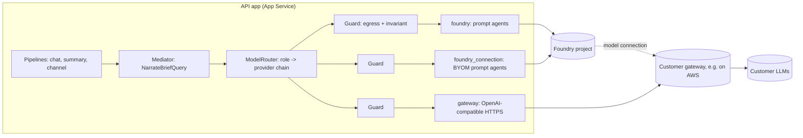

# AI gateway: how model access reaches the customer's own models

Customer-neutral. Status: AI-03 built and tested against a mock; the real gateway's
contract is **unknown** and is the list of questions at the end of this page.

## What this is for

The product's agents narrate engine output; they never compute. Which model does
the narrating is configuration. By default it is a Foundry prompt agent. A customer
may also require that inference run on models it already governs — behind its own
gateway, on its own cloud — and the product must work that way **without changing
a pipeline**. The gateway path exists for that: the customer's approved models and
existing AI governance.

It does not replace the Foundry path and is not meant to. See
[AI-PLATFORM-VALUE.md](AI-PLATFORM-VALUE.md) for what is available only, or best, on Foundry.

The gateway does **model inference only**. Tools stay on the Foundry/Azure side: if a
model asks for a tool the gateway returns an OpenAI-style `tool_calls` block and *we*
run it. The product's agents hold no tools at all, so today a `tool_calls` block is
dropped, not run.

## Provider chain semantics

`AI_PROVIDER_CHAIN` is an ordered list; `AI_PROVIDER_CHAIN__ROUTER|NARRATOR|ANALYSIS`
override it per role (for example narrator on the gateway, router on Foundry).

| Providers | What it is |
| --- | --- |
| `foundry` (default) | Foundry prompt agents, published and versioned by the app |
| `foundry_connection` | Foundry prompt agents whose model is `<connection>/<model>` (BYOM) |
| `gateway` | Direct OpenAI-compatible chat-completions calls, instructions as the system message |

Rules, the same in every order (`foundry,gateway`, `gateway,foundry`):

1. A provider that is not ready for the agent is skipped without a call.
2. The first provider answers. A failure **before any text** falls through to the next
   provider; the final event records every hop, so a fallback is visible.
3. A failure **after text has started** does not switch provider: splicing two models'
   sentences would show a reader something neither said. The caller appends the
   engine's own blocks instead.
4. Every provider is wrapped by the same guards (egress now; budget, bulkhead, breaker,
   retry and timeout in AI-04), so no provider can opt out.
5. If every provider fails the caller gets one typed error and the pipelines fall back
   to the engine's deterministic answer. The numeric guard and composer are unaffected
   by the provider [ADR-008].

## Authentication, in order of preference

The scheme is **pure configuration with no default**: a gateway in the chain without an
explicit `AI_GATEWAY_AUTH` stops startup.

| Rank | `AI_GATEWAY_AUTH` | Secret? | Use when |
| --- | --- | --- | --- |
| 1 | `entra_token` | none | The gateway validates Entra tokens or accepts federation. The app's managed identity requests a token for `AI_GATEWAY_ENTRA_AUDIENCE` |
| 2 | `oauth_client_credentials` | client secret | The gateway fronts an OAuth 2.0 provider. Token cached until 60 s before expiry; one refresh under a lock; a 401 drops it |
| 3 | `api_key` | key | A static key. Header and prefix are configurable (`Authorization: Bearer …`, `x-api-key: …`) |
| — | `none` | — | The mock and local development only; refused when `ENVIRONMENT` is not `local` |

**Secrets never live in the repository, tfvars or Terraform state.** A key or client
secret arrives as an App Service **Key Vault reference** (`enable_key_vault = true` and a
secret *name*; Terraform never creates the secret value). `scripts/create-model-connection.ps1`
does the same for a Foundry connection: the secret is read from Key Vault or a hidden
prompt and reaches the Bicep deployment through an environment variable.

## Data egress

`AI_EGRESS_POLICY` defaults to `allow_all`: the owner has confirmed no payroll PII needs
redaction. It stays a lever — `aggregates_only` refuses a prompt carrying row-grain keys
and `block` refuses everything — for providers **outside Microsoft's boundary**
(`gateway`, `foundry_connection`).

**One thing is not configurable:** an employee identifier or record token never enters a
prompt, for any provider, under any policy (`application/ai/egress.py`). It fails closed
and the reply is the engine's own blocks.

## Network requirements (customer actions; this repository adds no network resources)

- The API app routes all outbound traffic through its VNet (`vnet_route_all_enabled`).
  The gateway endpoint must be reachable from that egress: a NAT or firewall rule, and
  possibly an IP allow-list on the gateway's side.
- Reach it over **private connectivity** (VPN, ExpressRoute / Direct Connect, PrivateLink)
  with **private DNS** resolving the gateway name from the integration subnet.
- For a *Foundry* BYOM connection on a network-isolated Foundry, a non-APIM gateway must
  be reachable from the Agent Service network, not only from the app.
- `AI_GATEWAY_TLS_VERIFY=false` is refused when deployed.

## The gateway's required contract (what we need, and nothing more)

- HTTPS; base URL **without a path** (Foundry's convention).
- **OpenAI-compatible chat completions** — `POST /v1/chat/completions` (`openai_v1`) or
  `POST /openai/deployments/{model}/chat/completions?api-version=…` (`azure_deployments`).
  *Not* the Foundry Agents protocol, and not the Responses API.
- **Streaming** server-sent events ending `data: [DONE]`; a `stream_options.include_usage`
  usage chunk is used when present.
- **Tool calling** in the OpenAI shape (`tools`, `tool_calls`, `role: tool`), fragments
  keyed by `index`.
- 429 with `Retry-After` when rate limiting; 5xx for its own failures.

### Foundry BYOM limits (relevant only to `foundry_connection`)

Prompt agents only; the Responses API is not supported through BYOM; not supported with
the Microsoft Copilot harness; the model is a *Non-Microsoft Product* under the Product
Terms and the customer owns content safety and data handling. The hosted orchestrator
does **not** use BYOM — it calls the gateway directly with the same settings contract
(see `docs/m365-channel/ORCHESTRATOR.md`).
Source: <https://learn.microsoft.com/azure/foundry/agents/how-to/ai-gateway> (read 2026-11-02).

## Proving it without the real gateway

`scripts/mock-ai-gateway.py` is an OpenAI-compatible mock with streaming, tool calling,
all four auth modes and fault injection (latency, 429 + `Retry-After`, 5xx, hang, a stream
cut mid-way, malformed SSE). Tests drive it in-process; the same script can run as a
PoC App Service (`enable_mock_ai_gateway`, default off, public profile only — a Terraform
validation fails the plan in the enterprise profile). Deploying its code is a manual PoC
step (`az webapp deploy` of the script); Terraform creates only the empty app.

## Questions for the gateway team

Please send these to the team that runs the gateway. Until they are answered every item
below is an assumption.

1. **Authentication.** Which scheme: Entra token (audience?), OAuth 2.0 client credentials
   (token URL, scope, client registration process), or a static API key (header name and
   scheme)? How are credentials rotated?
2. **API dialect and paths.** Is it `POST /v1/chat/completions` or an Azure-style
   deployment path? Is there an `api-version`? Does the base URL carry a path prefix?
3. **Model names.** Exact names for a small fast model (routing), a narration model, and
   an analysis model. Are names stable, or versioned and retired?
4. **Streaming.** Does it stream SSE ending in `[DONE]`? Is token usage returned when
   `stream_options.include_usage` is set? Any buffering proxies that delay chunks?
5. **Tool calling.** Which models support it? Parallel tool calls? Any limit on tool schema size?
6. **Limits.** Requests and tokens per minute per client; maximum prompt size; the
   `Retry-After` convention; behaviour at the limit (429, 503, queueing).
7. **Connectivity.** Private connectivity option (VPN, Direct Connect, PrivateLink), the
   private DNS name, and the egress IPs we must allow-list in both directions.
8. **Latency.** Expected time to first token and total time for a 300-token answer;
   any SLO we should design timeouts against.
9. **Data handling.** Are prompts or completions logged or retained, where, and for how
   long? Where do models run (region)? Is customer data used for training? Content
   filtering applied by the gateway, if any.
10. **Operations.** Health endpoint, status page, maintenance windows, and a contact
    for incidents.
