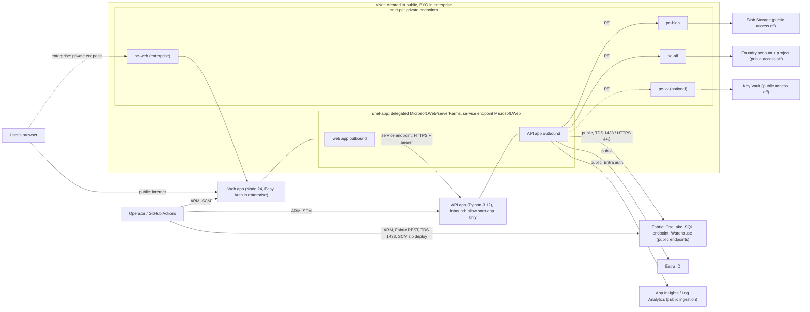

# Connectivity and Identity Matrix

**Requirements** DOC-3 / SEC-2 · **Seed** REQUIREMENTS §6 (internal planning),
corrected here against [`infra/`](../../infra/) and the code ·
**Companion** [INFRASTRUCTURE-COMPONENT-SPEC.md](INFRASTRUCTURE-COMPONENT-SPEC.md)

Each row is one caller reaching one target. **Network path** is one of:

- **public**: the target's public endpoint.
- **PE**: a private endpoint.
- **VNet integration**: App Service outbound through the integration subnet.
- **service endpoint**: the `Microsoft.Web` service endpoint on that subnet.

Both apps set `vnet_route_all_enabled = true`. Every outbound call from
either app therefore leaves through the integration subnet, including calls
to public endpoints, and follows that subnet's routing. In the enterprise
profile, the customer owns that routing.

## 1. Runtime paths

| # | From | To | Protocol / port | Network path | Identity | Permission | Token audience | Granted by |
|---|---|---|---|---|---|---|---|---|
| R1 | User's browser | Web app | HTTPS 443 | **public** profile: public (`web_inbound = public`). **enterprise**: PE `pe-web-<s>` (`privatelink.azurewebsites.net`); public network access off. Option: public with an IP allow-list (`access_restriction`) | public: none (anonymous). enterprise: Entra user, signed in by Easy Auth | Easy Auth `require_authentication = true`. Whether the web enterprise application requires user assignment isn't set by Terraform: customer decision | ID token for `web_client_id`. Access token for `<api_audience>/user_impersonation`, requested at login | Terraform `app_service` (inbound, Easy Auth). Customer (registrations, PE reachability) |
| R2 | Web app (`frontend/server`) | API app | HTTPS 443 to `API_BASE_URL` (API default hostname) | VNet integration → **service endpoint** `Microsoft.Web` → API access restriction `web-app-subnet` (allow the app subnet; default **Deny**). **There is no API private endpoint** | enterprise: the user's access token (`X-MS-TOKEN-AAD-ACCESS-TOKEN`), forwarded as `Authorization: Bearer`. Any browser-sent `Authorization` is dropped. public: none | The API checks the signature (tenant JWKS), `iss = https://login.microsoftonline.com/<tenant>/v2.0`, `aud` ∈ `API_AUDIENCE`, scope `user_impersonation` and app role **`TCC.User`**. 401 without proof; 403 without the scope or role, or for an unauthorized client | `API_AUDIENCE` (`api://<api_client_id>` or the bare client ID) | Terraform `app_service` (restriction), `network` (service endpoint, public profile). Customer (BYO subnet service endpoint; scope consent; `TCC.User` assignment) |
| R3 | API app | Entra ID (`login.microsoftonline.com`), JWKS | HTTPS 443 | VNet integration → public | none | public keys | n/a | `AUTH_MODE = entra` only |
| R4 | API app | Lakehouse via OneLake (`onelake.dfs.fabric.microsoft.com`, Delta over `abfss://`) | HTTPS 443 | VNet integration → public (Fabric private link not provisioned, NET-4) | API identity `id-tcc-api-<s>` | Fabric workspace role `fabric_workspace_role`, **default `Contributor`** | `https://storage.azure.com/.default` | Terraform `fabric` when `manage_fabric_access` (public default). Otherwise the customer's Fabric admin |
| R5 | API app | Lakehouse SQL analytics endpoint (`[<lakehouse>].[<schema>].[<table>]` on the Warehouse connection; aggregate reads) | TDS 1433 | VNet integration → public | API identity | Same workspace role as R4 | `https://database.windows.net/.default` | as R4 |
| R6 | API app | Warehouse (`WAREHOUSE_SERVER` / `WAREHOUSE_DATABASE`), schemas `tcc_gold`, `tcc_ops` | TDS 1433 | VNet integration → public | API identity | Workspace role (as R4) **and** T-SQL `GRANT SELECT, INSERT, UPDATE, DELETE ON SCHEMA::tcc_gold` and `::tcc_ops` `TO [<API_IDENTITY_NAME>]` | `https://database.windows.net/.default` | Terraform `fabric` (role, toggle). Script `scripts/grant-warehouse-sql.py` (grants) |
| R7 | API app | Blob Storage `sttcc<s>`, containers `artifacts`, `outputs` | HTTPS 443 | VNet integration → **PE** `pe-blob-<s>` (`privatelink.blob.core.windows.net`). Public network access off; shared key off | API identity | **Storage Blob Data Contributor, once per container** (two assignments; none at account scope) | `https://storage.azure.com/.default` | Terraform `storage` |
| R8 | API app | Foundry project `https://aif-tcc-<s>.services.ai.azure.com/api/projects/proj-tcc` | HTTPS 443 | VNet integration → **PE** `pe-aif-<s>` (zones `cognitiveservices`, `openai`, `services.ai`). Public network access off; local auth off | API identity | **Foundry User** (role GUID `53ca6127-db72-4b80-b1b0-d745d6d5456d`, formerly "Azure AI User") at **account** scope | `https://ai.azure.com/.default` | Terraform `foundry` |
| R9 | API app (platform Key Vault references) | Key Vault `kv-tcc-<s>` (only if `enable_key_vault`) | HTTPS 443 | VNet integration → **PE** `pe-kv-<s>` (`privatelink.vaultcore.azure.net`). Public access off | API identity, as `key_vault_reference_identity_id`. No application code calls Key Vault | Key Vault Secrets User, vault scope | Key Vault (resolved by App Service) | Terraform `keyvault` |
| R10 | API app | Application Insights ingestion (endpoint in the connection string) | HTTPS 443 | VNet integration → public (no Azure Monitor private link) | API identity (`APPLICATIONINSIGHTS_AUTHENTICATION_STRING`) | Monitoring Metrics Publisher on App Insights. Local auth is off, so the connection string alone can't write | `https://monitor.azure.com/.default` | Terraform `monitoring` |
| R11 | Web app | Application Insights ingestion | HTTPS 443 | VNet integration → public | web identity `id-tcc-web-<s>` | Monitoring Metrics Publisher on App Insights. The web server ships no telemetry SDK, so no application code uses this grant today | `https://monitor.azure.com/.default` | Terraform `monitoring` |
| R12 | Web app (Easy Auth platform) | Entra ID token endpoint | HTTPS 443 | public | web identity, as a federated credential for the web registration (`OVERRIDE_USE_MI_FIC_ASSERTION_CLIENTID`). There's no client secret | Sign-in and token exchange for `web_client_id` | n/a | Terraform (setting). Customer (federated credential on the web registration) |
| R13 | Apps, plan, storage, Key Vault, Foundry | Log Analytics `log-tcc-<s>` | Azure Monitor diagnostic settings | platform | platform | `diag-*` settings | n/a | Terraform (each module) |
| R14 | API app | Web IQ (`api.microsoft.ai`), optional | HTTPS 443 | VNet integration → public | key or token from `WEBIQ_*` settings | n/a | `https://api.microsoft.ai/.default` if a bearer is used | Not configured by Terraform. Inactive unless the operator adds the settings |

The API has **no** grant on the Fabric REST API, the Azure Resource Manager
API, or another app.

The web identity has **only** R11 and R12. It holds no data permission.

## 2. Operator and CI paths

| # | From | To | Protocol / port | Network path | Identity | Permission | Token audience | Granted by |
|---|---|---|---|---|---|---|---|---|
| O1 | Operator (`azd up` / `terraform apply`, local) | Azure Resource Manager | HTTPS 443 | public | deploying user (`az login`, `azd auth login`) | Create the resources and the role assignments in the component spec §4.13. Terraform never registers resource providers | ARM | Customer |
| O2 | Operator (Terraform `fabric` provider) | Fabric REST API (`api.fabric.microsoft.com`) | HTTPS 443 | public | deploying user (Azure CLI) | public profile: capacity admin (`fabric_capacity_admin`), so the user can create a workspace on the capacity. As the creator, the user can assign the workspace role | Fabric API | Terraform (`administration_members`). Customer (tenant settings) |
| O3 | Operator (azd postprovision: `apply-migrations.py`, `grant-warehouse-sql.py`, `seed-operational-store.ps1`) | Fabric REST API (target guard: resolves the workspace and Warehouse IDs and checks the endpoint before any SQL) | HTTPS 443 | public | deploying user (`DefaultAzureCredential`) | Read the workspace and Warehouse | `https://api.fabric.microsoft.com/.default` | as O2 |
| O4 | Operator (same scripts) | Warehouse | TDS 1433 | public | deploying user | DDL bootstrap or migrations, `GRANT`, and writes to `tcc_ops`. Needs workspace Admin or Member: the creator in public, the customer's grant in enterprise | `https://database.windows.net/.default` | Customer (enterprise) |
| O5 | Operator (postprovision load-synthetic, **public profile only**) | Lakehouse via OneLake | HTTPS 443 | public | deploying user | Write Delta tables under `SOURCE_SCHEMA` | `https://storage.azure.com/.default` | as O2 |
| O6 | Operator (`azd deploy`) | App Service SCM (Kudu) zip deploy, both apps | HTTPS 443 | public SCM (`scm_ip_restriction_default_action = Allow`). Enterprise web app: public network access off, which also covers SCM, so this needs a private path | deploying user. Basic-auth publishing is disabled, so Entra only | Deploy to the web apps (covered by Contributor) | ARM / Entra | Customer |
| C1 | GitHub Actions (`deploy.yml`, `workflow_dispatch` only) | Entra ID token exchange | HTTPS 443 | public | GitHub OIDC token → workflow app registration (federated credential, entity type *Environment*) | Exchange for an Entra token. No stored secret | `api://AzureADTokenExchange` | Customer ([OIDC-SETUP](OIDC-SETUP.md) §1) |
| C2 | GitHub Actions | Azure Resource Manager (target RG) | HTTPS 443 | public | workflow app (`ARM_USE_OIDC`) | **Contributor** plus **Role Based Access Control Administrator, constrained** to Storage Blob Data Contributor, Foundry User, Monitoring Metrics Publisher and Key Vault Secrets User, at resource-group scope. The run asserts the subscription and the RG's `azd-env-name` tag before `apply` | ARM | Customer |
| C3 | GitHub Actions | Terraform state storage account | HTTPS 443 | the customer's state account (network not set by this repo) | workflow app (`use_azuread_auth`, `use_oidc`) | Storage Blob Data Contributor on the state container | `https://storage.azure.com/.default` | Customer |
| C4 | GitHub Actions (Terraform `fabric` provider and the guard) | Fabric REST API | HTTPS 443 | public | workflow app (`FABRIC_USE_OIDC`) | The tenant setting must allow the app. With `create_fabric = false` it also needs a workspace role | Fabric API | Customer (Fabric admin) |
| C5 | GitHub Actions (`apply-migrations.py`, `grant-warehouse-sql.py`) | Warehouse | TDS 1433 | public | workflow app | Workspace **Admin or Member** (enterprise), for DDL and `GRANT`. `deploy.yml` doesn't run load-synthetic or the seed | `https://database.windows.net/.default` | Customer |
| C6 | GitHub Actions (`az webapp deploy`) | App Service SCM, both apps | HTTPS 443 | as O6 | workflow app | as O6 | ARM / Entra | Customer |
| C7 | GitHub Actions (`ci.yml`) | none in Azure | n/a | n/a | none. There's no `azure/login`, and `terraform test` runs on mock providers | n/a | n/a | n/a |
| P1 | Platform engineer | Log Analytics / App Insights | HTTPS 443 | public (portal / query API) | Entra user | For example Log Analytics Reader | Azure Monitor | Customer. Not granted by Terraform |

## 3. Corrections to the seed (REQUIREMENTS §6)

| Seed row | What the seed said | What infra/ and the code do |
|---|---|---|
| Analyst → Web | "Group assigned to web enterprise app" | Terraform doesn't set assignment-required. The binding control is the **`TCC.User` app role in the API token**, which the API enforces (403 without it). User assignment on the web registration is an optional customer control. In the **public** profile, the web app is anonymous and public (`AUTH_MODE = none`, no Easy Auth) |
| Web → API | `user_impersonation` only | Scope `user_impersonation` **and** app role `TCC.User` (D24). Network: a service endpoint plus an access restriction that allows only the integration subnet, **not a private endpoint** |
| API → Lakehouse | "Workspace Viewer / item ReadAll" | Workspace role **`Contributor`** by default (`fabric_workspace_role`). Item-level ReadAll isn't expressible in the provider. There are two read paths: OneLake (storage audience) and the Lakehouse SQL endpoint (database audience) |
| API → Warehouse | Post-deploy T-SQL | Correct, but it also needs the workspace role. The grant is `SELECT, INSERT, UPDATE, DELETE` per schema, made by `grant-warehouse-sql.py` from azd postprovision and from `deploy.yml` |
| API → Blob | Storage Blob Data Contributor (container scope) | Correct: two assignments, one per container (`artifacts`, `outputs`) |
| API → Foundry | Foundry User | Assigned by role GUID at **account** scope (not the project). The former display name was "Azure AI User" |
| API → Key Vault | Key Vault Secrets User | Correct, only with `enable_key_vault`. The platform uses it for Key Vault references; the code never calls Key Vault |
| API, Web → App Insights | Monitoring Metrics Publisher | Correct. The web identity's grant has no in-app caller today |
| GitHub Actions → RG | Contributor + RBAC Admin (constrained) | Correct. CI also needs Storage Blob Data Contributor on the state container, the Fabric tenant setting, and (enterprise) workspace Admin or Member |
| (missing) | — | Added: R3, R5, R12–R14, O1–O6, C1–C7 |

## 4. Network paths

## 5. What is NOT trusted

- **Network position alone is never trusted (AUTH-3).** The access restriction
  that limits the API to the integration subnet is defence in depth, not
  authentication. Under `AUTH_MODE = entra`, every API request except
  `/api/health` and `/api/ready` must carry a valid token, even from inside
  the subnet. Both apps share that subnet, and a BYO subnet may host other
  workloads too.
- **No browser-supplied credential reaches the API.** The web server drops
  the browser's `Authorization` header. It forwards only the token Easy Auth
  issued for the session.
- **No key or connection string is a credential.** The following are all off:
  storage shared keys, Foundry local auth, and App Insights local auth. There
  is no SAS and no blob URL in the browser. Downloads are streamed by the API,
  authorized per client, and recorded in `tcc_ops.artifact_access`.
- **A valid token isn't client entitlement.** Every client ID a request names
  is checked through the `ClientAuthorizer` port. v2 ships
  `AllClientsAuthorizer`: any `TCC.User` sees every client (D24).
- **The public profile trusts nobody and protects nothing beyond the data
  class.** The web app is anonymous and internet-facing with `AUTH_MODE =
  none`. That's why the profile serves `DATA_CLASSIFICATION = synthetic`
  only. A deployed API refuses to start with `AUTH_MODE = none` and
  `DATA_CLASSIFICATION = customer`.
- **The Fabric workspace role is broader than read.** The default
  `Contributor` lets the API identity write the Lakehouse as well as the
  Warehouse. The provider can't express a narrower item-level grant. A
  customer who needs read-only source access must grant it outside Terraform
  (`manage_fabric_access = false`).
