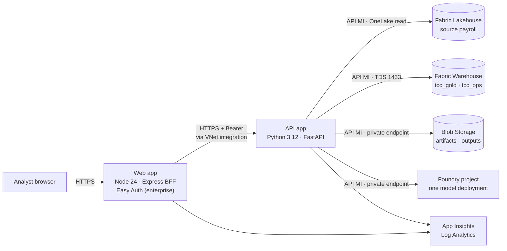

## Purpose

This is the operator's guide to deploying Tax Credit Copilot Platform v2. It
covers prerequisites, the two deployment profiles, the `azd` path, the CI path,
verification, teardown and known limitations.

Platform v2 runs on **two Azure App Service (Linux) apps on one plan**,
provisioned by **Terraform** (`infra/`), with the **Fabric Warehouse** as the
only operational store and the **Fabric Lakehouse** as the payroll source.
There is no Cosmos DB, no Container Apps environment, no container registry and
no Bicep.

| Read with | For |
|---|---|
| [INFRASTRUCTURE-COMPONENT-SPEC.md](INFRASTRUCTURE-COMPONENT-SPEC.md) | Every resource: SKU, settings, identity, network, diagnostics |
| [CONNECTIVITY-MATRIX.md](CONNECTIVITY-MATRIX.md) | Every hop: protocol, identity, permission, who grants it |
| [ENV-VARS.md](ENV-VARS.md) | Every app setting the API and web app read |
| [RUNBOOK.md](RUNBOOK.md) | Health checks and KQL for common failures |
| [FLOW-v2.md](FLOW-v2.md) | End-to-end flow: request, calculation run, claim package |
| [ADR-007](ADR-007-warehouse-operational-store.md) | Why the Warehouse is the only operational store |
| [docs/data/schema/migrations/README.md](../data/schema/migrations/README.md) | Schema bootstrap and forward-only migrations |
| [OIDC-SETUP.md](OIDC-SETUP.md) | One-time setup for the CI deploy identity |
| [SECURITY.md](../../SECURITY.md) | Security posture |

## What gets deployed



Terraform resources, by module (`infra/modules/`):

| Module | Creates |
|---|---|
| `identity` | Two user-assigned managed identities: `id-tcc-api-<suffix>` (all data access) and `id-tcc-web-<suffix>` (telemetry and Easy Auth only) |
| `network` | Public profile: VNet (`vnet_address_space`, default `10.40.0.0/16`), `snet-app` (delegated to `Microsoft.Web/serverFarms`, service endpoint `Microsoft.Web`), `snet-pe`, private DNS zones and links. Enterprise: nothing; passes BYO ids through |
| `monitoring` | Log Analytics (`PerGB2018`, 30-day retention), workspace-based App Insights with local authentication off, Monitoring Metrics Publisher for both identities |
| `app_service` | One Linux plan (`app_service_sku`, default `P1v3`), API app and web app, VNet integration on both, web private endpoint when `web_inbound = private_endpoint`, Easy Auth when the profile uses Entra, diagnostic settings |
| `storage` | StorageV2 ZRS, public network access off, shared key off, anonymous access off, TLS 1.2, versioning, containers `artifacts` and `outputs`, `outputs` lifecycle rule, blob private endpoint, Storage Blob Data Contributor per container for the API identity |
| `foundry` | AI Services account (local auth off, public network access off) and project via `azapi`, one model deployment (default `gpt-4.1-mini` `2025-04-14`, `GlobalStandard`, 20K TPM), private endpoint, **Foundry User** for the API identity (role GUID `53ca6127-db72-4b80-b1b0-d745d6d5456d`; formerly "Azure AI User") |
| `fabric` | Public profile: F2 capacity, workspace `tcc-<env>`, schema-enabled Lakehouse `tcc_lakehouse`, Warehouse `tcc_warehouse`. Optional workspace role for the API identity (`fabric_workspace_role`, default `Contributor`) |
| `keyvault` | Nothing by default. Created only with `enable_key_vault = true`; the stack holds no secrets |

The API app accepts inbound traffic only from the web app's integration subnet.
Every app setting comes from Terraform and none is a secret.

## The two profiles

`TCC_PROFILE` (`azd env set TCC_PROFILE public|enterprise`) selects the
profile. `infra/locals.tf` holds the matrix; each value can be overridden by
its own Terraform variable.

| Setting | `public` (default) | `enterprise` |
|---|---|---|
| `AUTH_MODE` / Easy Auth | `none` / off | `entra` / on |
| `DATA_CLASSIFICATION` | `synthetic` | `customer` |
| Fabric | `create_fabric = true`: F2 capacity, workspace, Lakehouse and Warehouse, DDL bootstrap, synthetic load | `create_fabric = false`: existing workspace, Lakehouse and Warehouse |
| `manage_fabric_access` (workspace role by Terraform) | `true` | `false` |
| Network | Creates VNet, subnets, private endpoints and DNS zones | Bring your own subnets and private DNS zone ids |
| `web_inbound` | `public` | `private_endpoint` |
| Key Vault | off | off unless `enable_key_vault` |

The public profile is a self-contained demo on synthetic data. The enterprise
profile is the shape for customer payroll. The API refuses to start with
`AUTH_MODE=none` and `DATA_CLASSIFICATION=customer` in a deployed environment
(`backend/application/deployment.py`).

### Enterprise inputs (bring your own)

[`infra/profiles/enterprise.tfvars.example`](../../infra/profiles/enterprise.tfvars.example)
lists every enterprise input with placeholders. Missing values stop the plan
before any resource is evaluated (cross-variable validation, Terraform 1.9+).

| Input | Requirement |
|---|---|
| `app_integration_subnet_id` | Existing subnet delegated to `Microsoft.Web/serverFarms`, with service endpoint `Microsoft.Web` (the API's access restriction names this subnet) |
| `private_endpoint_subnet_id` | Existing subnet for private endpoints |
| `private_dns_zone_ids` | Map with keys `blob`, `cognitiveservices`, `openai`, `aiservices` (required), `sites` (when `web_inbound = private_endpoint`) and `vault` (when Key Vault is enabled). Zones are usually centrally owned |
| `web_client_id`, `api_client_id`, `tenant_id`, `api_audience` | The customer's two app registrations (see [Entra](#entra-app-registrations-enterprise)) |
| `fabric_workspace_id`, `fabric_workspace_name`, `fabric_lakehouse_name`, `fabric_warehouse_id`, `warehouse_server`, `warehouse_database`, `source_schema` | The customer's existing Fabric items. The Warehouse is never bootstrapped; only pending migrations are applied |

Fabric private link and its DNS are **not provisioned** (NET-4). Whether the
tenant or workspace uses Fabric private link is a customer decision; the app's
outbound path must reach OneLake over HTTPS and the Warehouse endpoint on TDS
1433 either way.

## Prerequisites

### Tools

| Tool | Version | Used for |
|---|---|---|
| Azure Developer CLI (`azd`) | Not pinned by the repo; use a current release | `azd up` / `azd down` with the Terraform provider |
| Terraform | `>= 1.9.0` (`infra/providers.tf`); CI uses 1.16.5 | Provisioning. Providers pinned: `azurerm ~> 4.81.0`, `azapi ~> 2.13.0`, `fabric ~> 1.14.0` |
| Azure CLI (`az`) | Current release | Sign-in for Terraform's `azurerm` and `fabric` providers locally; resource provider registration |
| Python | 3.12 | Post-provision scripts. Install `backend/requirements.txt` (a `.venv` at the repo root is used if present) |
| ODBC Driver 18 for SQL Server | 18 | `apply-migrations.py` and `grant-warehouse-sql.py` connect to the Warehouse through `pyodbc` |
| Node.js | 24 (`frontend/package.json` engines `>=24`) | Building the web bundle in the `prepackage` hook |
| PowerShell (`pwsh`) | 7 | Runs `scripts/postprovision.ps1` on Windows and POSIX |

No Docker is needed. Both apps deploy as code (zip); the Dockerfiles are
optional and for local use only.

### Resource providers

Terraform is configured never to register resource providers
(`resource_provider_registrations = "none"` in `infra/providers.tf`), because
registration is a subscription-wide change. Register these before the first
deployment:

| Provider | When |
|---|---|
| `Microsoft.Web` | Always |
| `Microsoft.Storage` | Always |
| `Microsoft.CognitiveServices` | Always |
| `Microsoft.Network` | Always |
| `Microsoft.OperationalInsights` | Always |
| `Microsoft.Insights` | Always |
| `Microsoft.ManagedIdentity` | Always |
| `Microsoft.Fabric` | When Terraform creates Fabric (`create_fabric = true`, the public profile) |
| `Microsoft.KeyVault` | When `enable_key_vault = true` |

```pwsh
foreach ($ns in 'Microsoft.Web','Microsoft.Storage','Microsoft.CognitiveServices','Microsoft.Network',
                'Microsoft.OperationalInsights','Microsoft.Insights','Microsoft.ManagedIdentity','Microsoft.Fabric') {
  az provider register --namespace $ns
}
```

### Deploying identity

The identity that runs `azd up` (or the CI app registration) needs:

| Permission | Why |
|---|---|
| Contributor | Create and update the resources Terraform manages |
| Role Based Access Control Administrator, constrained to Storage Blob Data Contributor, Foundry User, Monitoring Metrics Publisher and Key Vault Secrets User | Terraform assigns those roles to the two app identities |
| Fabric workspace Admin or Member (enterprise) | `apply-migrations.py` and `grant-warehouse-sql.py` run T-SQL on the Warehouse as this identity |

Terraform declares the resource group (`azurerm_resource_group`), so the first
apply creates it. A group that already exists must be imported into state
first, or the apply fails.

### Entra app registrations (enterprise)

The customer creates two app registrations; Terraform only takes their ids
(D12, AUTH-1).

| Registration | Configuration |
|---|---|
| Web (Easy Auth client) | Redirect URI `https://<web host>/.auth/login/aad/callback`. Easy Auth authenticates with the web managed identity through a federated credential (app setting `OVERRIDE_USE_MI_FIC_ASSERTION_CLIENTID`), not a client secret. Assign the analyst group and require assignment |
| API (resource) | Exposes delegated scope `user_impersonation` and app role `TCC.User`. The API accepts only v2.0 tokens (issuer `https://login.microsoftonline.com/<tenant>/v2.0`); audience `api://<api client id>` unless `api_audience` is set |

A token without the scope or the role gets 403. A missing or invalid token
gets 401.

### Fabric

| Item | Public profile | Enterprise profile |
|---|---|---|
| Tenant setting *Service principals can use Fabric APIs* | Required for the API identity (and the CI app) | Required |
| Capacity | Created: F2 (`fabric_capacity_sku`), admin `FABRIC_CAPACITY_ADMIN` | Existing, active capacity. Sizing is a customer decision |
| Workspace, Lakehouse, Warehouse | Created by Terraform | Existing; ids are inputs |
| API identity workspace role | Terraform (`manage_fabric_access = true`) | The customer's Fabric admin assigns it (default expectation `Contributor`; Viewer alone cannot read OneLake files), unless `manage_fabric_access` is turned on |
| Schema grants on `tcc_gold`, `tcc_ops` | `scripts/grant-warehouse-sql.py` (post-provision) | Same |

The tenant setting has no API; a Fabric administrator sets it in the admin
portal.

## Deploy with azd

### 1. Create the environment

```pwsh
az login
azd auth login
azd env new <env-name> --no-prompt
azd env set AZURE_LOCATION <region>
azd env set AZURE_RESOURCE_GROUP <resource-group>
azd env set TCC_PROFILE public                     # or enterprise
azd env set GIT_COMMIT (git rev-parse HEAD)        # stamps every run with the commit
```

Public profile also:

```pwsh
azd env set FABRIC_CAPACITY_ADMIN (az ad signed-in-user show --query userPrincipalName -o tsv)
```

Enterprise profile: set every enterprise value in the table below with
`azd env set`. Put `private_dns_zone_ids`, and any other variable
`infra/main.tfvars.json` does not map, in a gitignored overlay such as
`infra/enterprise.auto.tfvars`. Do not put a mapped value only in an overlay:
`main.tfvars.json` passes the azd value (empty if unset) for every mapped
variable.

### 2. Environment values

`infra/main.tfvars.json` maps these azd values into Terraform variables.

| azd value | Terraform variable | Profile | Purpose / failure mode when unset |
|---|---|---|---|
| `TCC_PROFILE` | `profile` | both | `public` (default) or `enterprise`. Selects every profile default |
| `AZURE_LOCATION` | `location` | both | Region for every resource |
| `AZURE_RESOURCE_GROUP` | `resource_group_name` | both | Group Terraform creates; empty uses `rg-<env>` |
| `FABRIC_CAPACITY_ADMIN` | `fabric_capacity_admin` | public | UPN made admin of the F2 capacity. Required when Fabric is created; the plan fails without it |
| `SOURCE_SCHEMA` | `source_schema` | both | Lakehouse schema holding source payroll (default `flex`) |
| `GIT_COMMIT` | `git_commit` | both | Recorded on every run manifest. Unset, runs record `working-tree` |
| `FOUNDRY_MODEL`, `FOUNDRY_MODEL_VERSION` | `foundry_model`, `foundry_model_version` | both | Model the narrating agents use (default `gpt-4.1-mini` / `2025-04-14`). Check regional availability and quota |
| `TCC_APP_SERVICE_SKU` | `app_service_sku` | both | Plan SKU shared by both apps (default `P1v3`) |
| `TCC_TENANT_ID` | `tenant_id` | enterprise | Entra tenant for Easy Auth and token validation; empty uses the deployer's tenant |
| `TCC_WEB_CLIENT_ID` | `web_client_id` | enterprise | Web app registration (Easy Auth). Required: the plan fails without it |
| `TCC_API_CLIENT_ID` | `api_client_id` | enterprise | API app registration (`user_impersonation`, role `TCC.User`). Required |
| `TCC_API_AUDIENCE` | `api_audience` | enterprise | Audience the API validates; empty uses `api://<api client id>` |
| `TCC_APP_SUBNET_ID` | `app_integration_subnet_id` | enterprise | BYO integration subnet. Required |
| `TCC_PRIVATE_ENDPOINT_SUBNET_ID` | `private_endpoint_subnet_id` | enterprise | BYO private-endpoint subnet. Required |
| `TCC_FABRIC_WORKSPACE_ID`, `TCC_FABRIC_WORKSPACE_NAME` | `fabric_workspace_id`, `fabric_workspace_name` | enterprise | Existing workspace. Id required |
| `TCC_FABRIC_LAKEHOUSE_NAME` | `fabric_lakehouse_name` | enterprise | Lakehouse holding the source schema |
| `TCC_FABRIC_WAREHOUSE_ID`, `TCC_WAREHOUSE_SERVER`, `TCC_WAREHOUSE_DATABASE` | `fabric_warehouse_id`, `warehouse_server`, `warehouse_database` | enterprise | Existing Warehouse for `tcc_gold` / `tcc_ops`. Required; never bootstrapped (D22) |

`AZURE_ENV_NAME` and `AZURE_SUBSCRIPTION_ID` are written by azd.
`backend/tests/test_deployment_docs_contract.py` fails the build if a value
reaches `main.tfvars.json` without appearing in this table.

Variables with defaults that azd does not map (set them in an overlay or, in
CI, `TF_VARS_JSON`): `auth_mode`, `data_classification`, `create_fabric`,
`manage_fabric_access`, `create_network`, `web_inbound`,
`web_allowed_ip_ranges`, `enable_key_vault`, `api_worker_count`,
`vnet_address_space`, `private_dns_zone_ids`, `fabric_capacity_sku`,
`fabric_workspace_role`, `foundry_deployment_sku`, `foundry_capacity`,
`ai_gateway_endpoint`, `outputs_retention_days`, `tags`. See
`infra/variables.tf` for each default.

### 3. Run it

```pwsh
azd up --no-prompt
```

`azd up` runs, in order:

1. **Provision.** `terraform apply` with the values above. Outputs (app names,
   URLs, Warehouse endpoint, Fabric ids, `TCC_FABRIC_CREATED`,
   `API_IDENTITY_NAME`, …) are written back into the azd environment.
2. **Post-provision** (`scripts/postprovision.ps1`). It first checks that
   `WAREHOUSE_SERVER`, `WAREHOUSE_DATABASE`, `FABRIC_WORKSPACE_ID` and
   `FABRIC_WAREHOUSE_ID` are set. Every SQL step targets `deployed`, which the
   guard resolves through the Fabric API and checks against those values
   before executing anything.
   1. `apply-migrations.py`: `--bootstrap` (DDL v2.0) only when
      `TCC_FABRIC_CREATED=true`, i.e. Terraform just created this Warehouse.
      Otherwise it applies pending migrations only. A re-run applies nothing.
   2. Synthetic load (public profile only):
      `python -m data.source.load_fabric --synthetic-only` into the new Lakehouse.
   3. `grant-warehouse-sql.py`: `GRANT SELECT, INSERT, UPDATE, DELETE` on
      `tcc_gold` and `tcc_ops` to the API identity. Idempotent.
   4. `seed-operational-store.ps1`: idempotent onboarding rows in `tcc_ops`.
3. **Package.** The web `prepackage` hook runs `npm ci --legacy-peer-deps` and
   `npm run build`. `.webappignore` files keep `.env` and payroll out of both
   packages.
4. **Deploy.** Zip deploy of both apps (matched by the `azd-service-name` tags
   `api` and `web`). App Service builds on deploy
   (`SCM_DO_BUILD_DURING_DEPLOYMENT=true`); the API starts with
   `backend/startup.sh` (gunicorn with uvicorn workers, `--timeout 600`).

`azd up` is idempotent. A second `azd provision --preview` shows no changes.

For an enterprise deployment, also have the customer's Fabric admin assign the
API identity (`API_IDENTITY_NAME` / `API_IDENTITY_PRINCIPAL_ID` in the azd
environment) its workspace role, unless `manage_fabric_access` is on.

## Deploy with CI

`.github/workflows/deploy.yml` deploys with GitHub OIDC. It runs only on
`workflow_dispatch` (inputs: `profile`, `environment`); there is no push
trigger. One-time setup (app registration, federated credential, roles, GitHub
variables) is in [OIDC-SETUP.md](OIDC-SETUP.md).

**Remote state is required.** Create the state storage account once, out of
band, with Entra auth and versioning on, and grant the deploy identity Storage
Blob Data Contributor on the state container.
[`infra/backend.azurerm.tf.example`](../../infra/backend.azurerm.tf.example)
shows the backend block; the workflow writes its own from the
`TF_BACKEND_RESOURCE_GROUP`, `TF_BACKEND_STORAGE_ACCOUNT` and
`TF_BACKEND_CONTAINER` variables, with state key
`tax-credit-copilot/<AZURE_ENV_NAME>.tfstate`.

**Inputs.** `AZURE_ENV_NAME`, `AZURE_LOCATION`, `AZURE_RESOURCE_GROUP` and
`AZURE_SUBSCRIPTION_ID` become `TF_VAR_*`; `git_commit` is `github.sha`. Enterprise
BYO inputs (subnet ids, `private_dns_zone_ids`, Fabric ids, app registration
client ids) go in one `TF_VARS_JSON` variable, written to
`deploy.auto.tfvars.json`. No secret belongs in it.

The run, in order:

1. CI gate (`ci.yml`): backend and frontend suites, gitleaks, Terraform
   `fmt -check`, `validate`, `tflint`, `terraform test`.
2. Fail fast if any required variable is missing.
3. OIDC login; assert the subscription, and that an existing resource group
   is tagged for this environment.
4. `terraform init` (remote state), `plan`, `apply`.
5. Install ODBC Driver 18 and backend dependencies; `apply-migrations.py`
   (bootstrap only if this run created the Warehouse); `grant-warehouse-sql.py`.
6. Build the bundle; package with `scripts/package-app.py` (same `.webappignore`
   rules as azd); `az webapp deploy` both apps.
7. Public profile only: poll the web app's `/healthz`.

## Verify after deploy

These checks passed in both live public-profile smoke deployments.
Load the azd environment into the shell first:

```pwsh
azd env get-values | ForEach-Object { if ($_ -match '^([^=]+)="?(.*?)"?$') { Set-Item "env:$($Matches[1])" $Matches[2] } }
$web = $env:WEB_BASE_URL
```

- [ ] **(a) Web app serves.** `GET $web/` returns 200.
- [ ] **(b) API is healthy and ready.** `GET $web/api/health` returns 200 and
      `GET $web/api/ready` returns `"ready": true` (allow up to 10 minutes after
      a cold start). A direct call to `$env:API_BASE_URL/api/health` returns
      **403**: that is correct, the API accepts only the web app's subnet.
- [ ] **(c) A calculation run writes Gold.** Pick a client from
      `GET $web/api/scope`, then
      `POST $web/api/v2/clients/<id>/runs` with body `{"year": <tax year>, "state": "GA"}`.
      Poll `GET $web/api/v2/clients/<id>/runs/latest` until `run_status` is
      `success`, then `GET $web/api/v2/clients/<id>/units` returns rows.
- [ ] **(d) Claim package and audited download.**
      `POST $web/api/clients/<id>/packages?tax_year=<year>` returns 201 with an
      `artifact_id`. `GET $web/api/clients/<id>/artifacts/<artifact_id>` returns
      200 and an XLSX whose SHA-256 matches the `X-Content-SHA256` header.
      `tcc_ops.artifact_access` has a row with `outcome = served`.
- [ ] **(e) Telemetry arrives.** In Log Analytics,
      `AppRequests | where TimeGenerated > ago(30m) | summarize count() by Name`
      returns the API routes you just called.
- [ ] **(f) Idempotent.** `azd provision --preview` reports no changes;
      `python scripts/apply-migrations.py --target deployed` reports 0 pending;
      `python scripts/run-sql.py --target deployed --file docs/data/schema/tcc-schema.fabric.sql --section 9 --expect-empty`
      exits 0.

Under the enterprise profile the web app sits behind a private endpoint and
Easy Auth. Run the checks from inside the network with a signed-in browser;
(c) and (d) are the client page's *Run calculation* and *Download claim
package* actions.

`/api/health` returning 200 does not prove Fabric is reachable. Check (c)
does. See [RUNBOOK.md](RUNBOOK.md) for the failure signatures.

## Teardown

```pwsh
azd down --purge --force --no-prompt
az group exists --name <resource-group>     # expect false
```

`terraform destroy` removes everything Terraform created, including the F2
capacity and Fabric items in the public profile. The Foundry account is purged
by a destroy-time action and Key Vault (if enabled) by the provider, so nothing
is left in soft-delete. Observed teardown time was approximately 6–12 minutes.

> [!CAUTION]
> The provider sets `prevent_deletion_if_contains_resources = false`, so
> deleting the resource group also deletes resources Terraform did not create
> in it. Do not place other resources in this group.

For a CI-deployed environment there is no teardown workflow. Run
`terraform destroy` from `infra/` against the same remote state and variables.
Enterprise BYO network, DNS and Fabric items are not created by Terraform and
are not destroyed.

## Known limitations

| Limitation | Effect and workaround |
|---|---|
| Calculation runs are synchronous | `POST /api/v2/clients/{id}/runs` through the web app can hit App Service's ~230 s front-end timeout while the run completes server-side (gunicorn `--timeout 600`). Poll `GET /api/v2/clients/{id}/runs/latest` |
| First Gold write is slow | Warehouse inserts run at roughly 30–160 rows/s; a large client's first full write can take tens of minutes |
| Paused or expired Fabric capacity | Every data path fails with `ArtifactNotFound` or connection errors while `/api/health` stays 200. Check the capacity first |
| Transient management-plane resets | TLS or connection resets to `management.azure.com` and `api.fabric.microsoft.com` were seen. Scripts retry Fabric REST calls; re-run `azd up` on a transient ARM error |
| Warehouse write conflicts | Snapshot-isolation conflicts (24556, 3960) and deadlocks (1205) are retried in `tenant_sql.py`: 5 attempts, 0.2 s doubling, 3.2 s cap |
| Two grants Terraform cannot make | The Fabric tenant setting for service principals, and (enterprise, `manage_fabric_access = false`) the API identity's workspace role |
| CI does not load data or seed | `deploy.yml` runs migrations and grants only. A public-profile deploy through CI gets an empty Lakehouse and no seeded `tcc_ops` rows; use `azd up` for the demo |
| Enterprise profile not deployed live | Phase A validated it with `terraform validate` and mock-provider tests only |
| `ai_gateway_endpoint` is not wired | Terraform sets `AI_GATEWAY_ENDPOINT`, but no backend code reads it. Agent traffic goes directly to the Foundry project |
| Client authorization is all-or-nothing | v2 ships `AllClientsAuthorizer`: any caller with `TCC.User` sees every client (D24) |
| API CORS allows any origin | `allow_origins=["*"]` in `backend/main.py`. Inbound is limited to the web app's subnet and, under Entra, every request needs a valid bearer token |
| Fabric private link | Not provisioned; a customer decision (NET-4) |
| Commit stamp | Without `GIT_COMMIT` in the azd environment, runs record `working-tree` |
| Peer dependencies | `frontend/.npmrc` sets `legacy-peer-deps` because `react-simple-maps@1` peer-locks React 16 |
| Terraform lock file | Not committed; providers are pinned to patch level in `providers.tf` |

## Cost drivers

No prices are given here; run the chosen region and SKUs through the Azure and
Fabric pricing tools.

| Component | Shape |
|---|---|
| App Service plan | One plan (`P1v3` default), Always On, shared by both apps |
| Fabric capacity | Public profile: an F2 billed while it runs. Enterprise: the customer's capacity, which also carries Warehouse reads and writes |
| Foundry | Token usage on one `GlobalStandard` deployment (20K TPM default) |
| Monitoring | Log Analytics ingestion, 30-day retention |
| Storage | StorageV2 ZRS, versioning, 30-day soft delete; `outputs` kept for `outputs_retention_days` (default 2555) |
| Networking | Private endpoints for blob and Foundry (and web, Key Vault when used) |

## AI boundary

Deterministic Python computes every figure; agents narrate a brief built from
those figures ([ADR-004](ADR-004-agentic-workflows.md)). Prompts carry
aggregates, not payroll rows, names or employee ids. The user's own chat text
is sent as typed. The API calls Foundry as its managed identity, which holds
**Foundry User** (formerly Azure AI User); local key auth is off. If Foundry is
unreachable, every non-chat screen still works. See
[FLOW-v2.md](FLOW-v2.md).

## Open items

| Item | Owner |
|---|---|
| App registration ids, analyst group, tenant | Customer (Entra) |
| Fabric private link and DNS model | Customer |
| AI gateway contract, if model traffic must route through one | Customer, then application change |
| Production Fabric capacity sizing and ownership | Customer |
