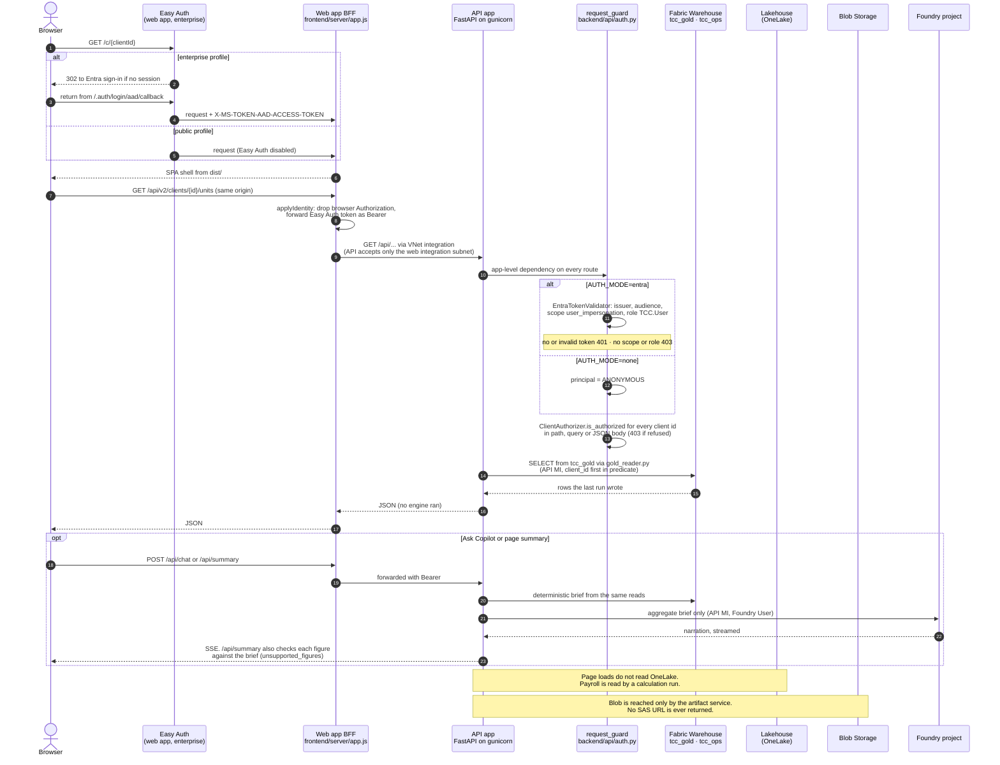
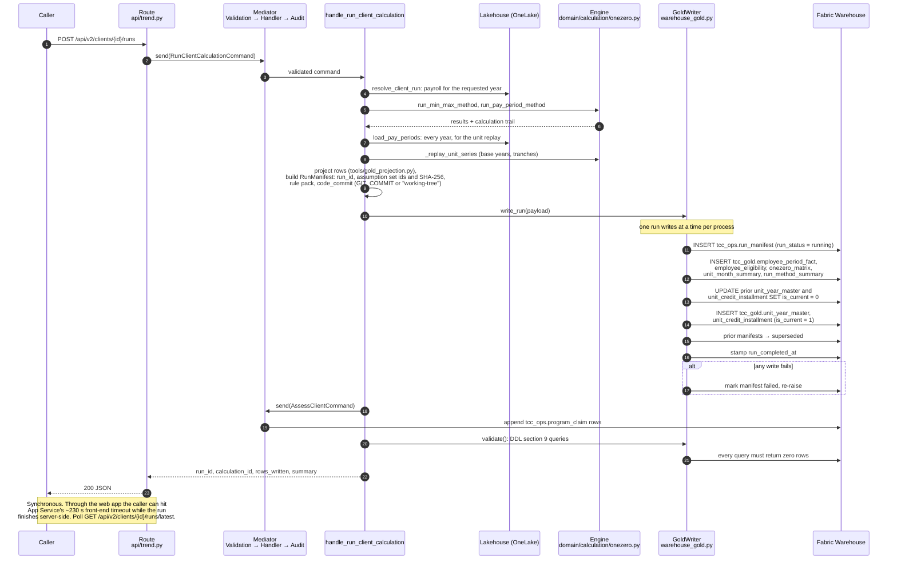
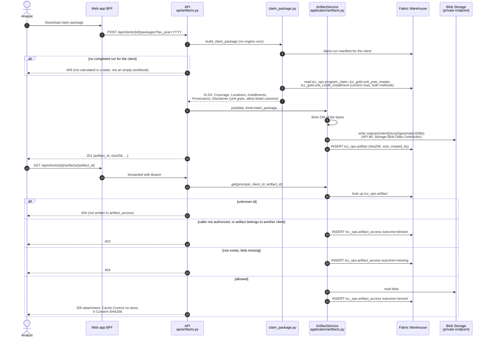

# End-to-end flow (Platform v2)

How payroll becomes a figure on a screen and a file in a claim package, in
Platform v2: two App Service apps, the Fabric Lakehouse for source payroll, the
Fabric Warehouse as the only operational store, Blob Storage for files and
Foundry for narration. Cosmos DB, Container Apps and the container registry are
gone ([ADR-007](ADR-007-warehouse-operational-store.md)).

Two rules hold on every path below:

- **Deterministic Python computes every figure.** Agents receive a brief built
  from figures already computed and only narrate it. They hold no tools
  ([ADR-004](ADR-004-agentic-workflows.md)).
- **The engine runs at write time.** A page load reads Gold (`tcc_gold.*`) and
  runs no engine. Only a calculation run, or a forecast to an arbitrary as-of
  date, computes.

Related: [DEPLOYMENT-HANDOVER.md](DEPLOYMENT-HANDOVER.md) ·
[CONNECTIVITY-MATRIX.md](CONNECTIVITY-MATRIX.md) ·
[CALCULATION-PROVENANCE.md](CALCULATION-PROVENANCE.md) ·
[c4/model.json](c4/model.json).

## The five stages

| # | Stage | Where it runs | Writes |
|---|---|---|---|
| 1 | **Land** payroll in the Lakehouse | Customer pipeline (enterprise) or the post-provision synthetic load (public profile) | Lakehouse tables in `SOURCE_SCHEMA` |
| 2 | **Read** one client's payroll and statute | API: `application/queries/_client_run.py` | Nothing |
| 3 | **Calculate** both certified methods | API: `domain/calculation/` (pure Python) | Nothing; the trail is recorded in memory |
| 4 | **Persist** Gold and the run manifest | API: `infrastructure/persistence/warehouse_gold.py` | `tcc_ops.run_manifest`, `tcc_gold.*`, `tcc_ops.program_claim` |
| 5 | **Serve** reads, decisions, packages and narration | API routers, read from Gold | `tcc_ops` decisions, Blob `outputs`, `tcc_ops.artifact*` |

```mermaid
flowchart LR
    subgraph S1["1 · Land"]
        PIPE["Customer payroll pipeline<br/>(not part of this system)"]
        SYN["Public profile only:<br/>postprovision.ps1 →<br/>python -m data.source.load_fabric --synthetic-only"]
        LH[("Fabric Lakehouse<br/>SOURCE_SCHEMA tables")]
        PIPE --> LH
        SYN --> LH
    end

    subgraph S2["2 · Read"]
        RCR["resolve_client_run<br/>application/queries/_client_run.py"]
        RP["Year rule pack<br/>rules/PROGRAM/YEAR.json"]
        FW["Fiscal window<br/>infrastructure/payroll/fiscal_source.py"]
        PP["Pay periods over OneLake<br/>infrastructure/payroll/pay_period_source.py<br/>data/source/from_fabric.py"]
        RP --> RCR
        FW --> RCR
        PP --> RCR
    end

    subgraph S3["3 · Calculate (deterministic)"]
        ENG["run_min_max_method · run_pay_period_method<br/>domain/calculation/onezero.py"]
        TR["Calculation trail + SHA-256<br/>domain/calculation/trail.py"]
        PROJ["Gold projections<br/>tools/gold_projection.py"]
        ENG --> TR
        ENG --> PROJ
    end

    subgraph S4["4 · Persist"]
        GW["GoldWriter.write_run<br/>infrastructure/persistence/warehouse_gold.py"]
        WH[("Fabric Warehouse<br/>tcc_ops.run_manifest<br/>tcc_gold.*<br/>tcc_ops.program_claim")]
        GW --> WH
    end

    subgraph S5["5 · Serve"]
        RD["Reads: gold_reader.py<br/>/api/v2/portfolio · /api/v2/clients/{id}/units"]
        DEC["Decisions: mediator commands<br/>tcc_ops claims, findings, overrides"]
        PKG["Claim package<br/>/api/clients/{id}/packages"]
        BLOB[("Blob Storage<br/>outputs container")]
        AI["Narration only<br/>Foundry agents"]
        PKG --> BLOB
    end

    LH -->|"API MI · OneLake read"| PP
    RCR --> ENG
    PROJ --> GW
    WH --> RD
    WH --> PKG
    DEC --> WH
    PKG -->|"tcc_ops.artifact"| WH
    RD -->|"aggregate brief"| AI
```

### Stage notes

1. **Land.** The Lakehouse is the source of truth for payroll. The app never
   writes to it. In the public profile, `scripts/postprovision.ps1` loads the
   synthetic dataset into the Lakehouse Terraform just created.
2. **Read.** One resolver answers the four questions every per-client run
   needs: programme, statute, fiscal window and payroll rows. The API reads
   Delta over OneLake as its user-assigned managed identity (token audience
   `https://storage.azure.com/`). Payroll is held in memory for the run.
3. **Calculate.** `run_client_calculation` calls the certified engine; it does
   not change it. Every step records `{step, inputs, formula, output, citation}`
   ([CALCULATION-PROVENANCE.md](CALCULATION-PROVENANCE.md)). The unit series is
   replayed over every year the payroll covers, because a base year needs the
   whole series. No model is involved.
4. **Persist.** See the run sequence below. Every Warehouse statement goes
   through `infrastructure/persistence/tenant_sql.py`, which puts `client_id`
   first in the predicate (token audience `https://database.windows.net/`).
5. **Serve.** Screens read Gold. Decisions are commands through the mediator
   (`application/mediator.py`: Validation → Handler → Audit). Files go through
   the artifact service. Agents narrate a brief built from the same reads.

## A user request

What happens when an analyst opens a page. Under the public profile
(`AUTH_MODE=none`) Easy Auth is off and the caller is anonymous; under the
enterprise profile (`AUTH_MODE=entra`) both checks below are enforced.

Points worth knowing:

- `/api/health` and `/api/ready` are exempt from `request_guard`; the platform
  calls them without a token. The web app's own probe is `/healthz`, excluded
  from Easy Auth.
- A direct call to the API hostname from outside the web app's integration
  subnet returns 403 (App Service access restriction).
- If Foundry is unreachable, every screen still renders. Only narration is
  lost.

## A calculation run

`POST /api/v2/clients/{client_id}/runs` (route in `backend/api/trend.py`)
dispatches `RunClientCalculationCommand` to
`backend/application/commands/run_client_calculation.py`. The request body is
`{"year": <tax year>, "state": "GA", "triggered_by": ..., "assess_years": [...]}`.

- **Append-only.** A rerun writes a new `run_id`. Prior rows are retired, never
  updated in place, because a superseded figure may already be on a filed
  return.
- **Order, not one transaction.** The manifest lands first so no Gold row is
  orphaned, and the prior run is superseded last so a failure mid-write leaves
  the previous run current.
- **Conflicts are retried.** Warehouse errors 24556, 3960 and 1205 are retried
  in `tenant_sql.py` (5 attempts, 0.2 s doubling, 3.2 s cap).
- **`GET /api/v2/clients/{id}/runs/latest`** reads the manifest. A 404 means
  "not yet calculated", which is a state, not a zero.

## A claim package and an audited download

`POST /api/clients/{client_id}/packages?tax_year=` and
`GET /api/clients/{client_id}/artifacts/{artifact_id}` live in
`backend/api/artifacts.py`. The workbook is built by
`backend/application/claim_package.py`; bytes move through `ArtifactService` in
`backend/application/artifacts.py`.

- The storage account has public network access, shared-key access and
  anonymous access off. The browser never receives a SAS; the API streams the
  bytes.
- The download route authorizes inside the handler (`SELF_AUTHORIZING` in
  `api/auth.py`), so a refusal is recorded where it happens.
- The `outputs` container has a lifecycle rule (`outputs_retention_days`,
  default 2555 days).

## Where each figure comes from

| Figure | Computed by | Stored in | Read by |
|---|---|---|---|
| Eligibility (Min-Max, Pay Period) | `domain/calculation/onezero.py` | `tcc_gold.employee_eligibility`, `onezero_matrix` | Eligibility and One/Zero views, employee drill |
| Unit headcount, base year, credit tranches | `_replay_unit_series` in `run_client_calculation.py` | `tcc_gold.unit_year_master`, `unit_credit_installment`, `unit_month_summary` | Client and unit pages, claim package |
| Run-level totals (incl. `contested_months`) | Engine results | `tcc_gold.run_method_summary` | Progress and chat reads |
| Identified credit per client-year | `AssessClientCommand` | `tcc_ops.program_claim` | Portfolio book, claim package |
| Narration | Foundry agent, from a deterministic brief | Not stored as a figure | Chat panel, page summary |

## What changed from v1

| v1 | v2 |
|---|---|
| Cosmos DB for claims, engagements and findings | `tcc_ops.program_claim`, `program_engagement`, `agent_finding_resolution` in the Warehouse |
| nginx container proxying `/api` | Node 24 Express BFF on App Service, forwarding the Easy Auth token |
| API container on Container Apps, images in ACR | Python 3.12 code deploy on App Service (`backend/startup.sh`) |
| No end-user authentication | `AUTH_MODE=entra`: Easy Auth on the web app, bearer validation on the API |
| No file exports | Claim package XLSX through the artifact service, every download audited |
| Bicep | Terraform in `infra/` |
