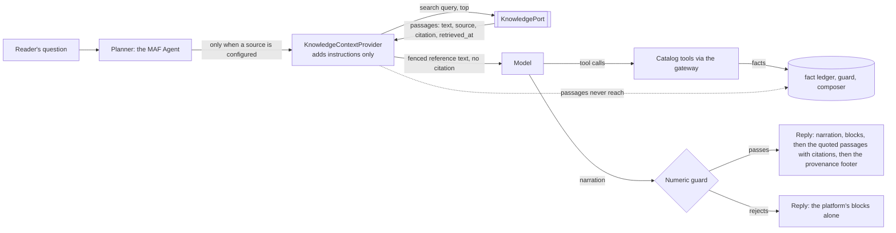

# Knowledge and IQ: reference text with citations, and why the rest stays off

Customer-neutral. Decision: [ADR-010](ADR-010-knowledge-tier.md). Built by RM-15 (2026-11-04): the port, a fake, a framework context provider and the
tests. **Not built:** the Foundry IQ adapter, and every Azure resource it needs. **Off by default.** Product names, statuses and limits below were
read from Microsoft Learn on 2026-11-04 and carry the page's own date; this area moves quickly, so re-read before acting. What could not be verified is
listed at the end and marked **[unverified]** where it appears.

## 1. What exists, and what it does

| Piece | Where | Role |
| --- | --- | --- |
| `Passage`, `KnowledgePort`, `render_reference`, `model_context` | `backend/application/knowledge/port.py` | The contract and the two renderings (reader, model). Standard library only; vendored |
| `KnowledgeSettings`, `load_knowledge_settings`, `build_knowledge` | `backend/application/knowledge/settings.py` | `KNOWLEDGE_ENABLED` (default false), `KNOWLEDGE_PROVIDER` (`none`, `fake`, `foundry-iq`; only the first two exist), `KNOWLEDGE_TOP` (1 to 10, default 3) |
| `FakeKnowledge`, `SYNTHETIC_CORPUS` | `backend/application/knowledge/fake.py` | Deterministic keyword retrieval over a built-in synthetic corpus, labelled "not statute", with made-up figures on purpose |
| `KnowledgeContextProvider` | `channel_orchestrator/app/core/maf_knowledge.py` | The framework `ContextProvider`: `before_run` searches and calls `extend_instructions`; nothing else |
| Planner, `Planned.reference`, `TurnPipeline._assemble` | `app/core/planner.py`, `planned.py`, `turn.py` | Build the provider only when a source exists; keep the passages; print them after a surviving narration |

**What a reader sees.** With the tier on and a narration that passed the guard, the reply gains a block after the narration: a fixed header ("quoted from the
cited sources; not computed by the engine, and no figure above comes from it"), then each passage quoted with its citation, source and retrieval date. When the
narration is dropped the block is not shown: reference text appears only beside the sentence it may have informed. The provenance footer stays last.

**What the model is told.** The passages as fenced untrusted text under a fixed header: background to read, not facts; write no figure from it; refer to a
source only as "the cited source". The citation is withheld from the model (it holds digits a model could copy); the platform prints it.

**Degraded paths.** The `json` and `keywords` planners never consult the tier: they have no model loop to carry a context provider. A knowledge source that
raises costs the reader nothing; the turn goes on without reference text and logs the exception type only.

## 2. The rule: figures never come from knowledge

A figure on a reply is a fact an engine tool produced, rendered by the one formatter and checked by the guard ([ADR-008](ADR-008-channel-numeric-integrity.md)).
Reference text is none of that.

1. **A passage is never a fact.** It has four fields (`text`, `source`, `citation`, `retrieved_at`), no number field and no path a `{{facts.…}}` placeholder can
   name (a placeholder into reference text drops the narration).
2. **The guard trusts its facts.** It reads numerals out of prose placed among the facts (`test_the_guard_trusts_its_facts_so_the_rule_is_that_a_passage_is_never_one`
   pins this). So the protection is structural, not a property of the guard: nothing in the tier can reach the fact index, the ledger, a tool result or the
   reader's allowed numerals. `tests/test_architecture_knowledge.py` enforces it: an import allow-list for the tier, no fact or ledger name used in it, the
   provider may only call `extend_instructions`, five named orchestrator modules may import the tier and none is on the figure path, nothing in the backend
   imports it, and the ledger is written by `channel/pipeline.py` alone. The scanner is proved on seeded violations and two real mutations of the tree failed the suite.
3. **A model that repeats a passage's figure is rejected like any typed digit.** Every spelling is tested (`$9,876`, `9876`, `9,876.00`, `$9.9k`, `9876 jobs`), through the
   real orchestrator turn as well as the composer.
4. **The engine's rule packs remain the only statutory figures.** A rate, a threshold or a floor comes from `rules/<program>/<year>.json` through the engine, with its
   hash ([ADR-005](ADR-005-year-versioned-rules.md)); an ingested or quoted figure never overrides one.
5. **A passage without a citation cannot exist,** and a time zone is required on `retrieved_at`.

## 3. Foundry IQ for statute and rules text (the first real source; not built)

**Names and status (Microsoft Learn, read 2026-11-04).**

| Item | What the documentation says | Page and date |
| --- | --- | --- |
| Foundry IQ | A managed knowledge layer: a knowledge base of knowledge sources, queried with agentic retrieval, returning grounded content with citations; usable from Foundry Agent Service, the Microsoft Agent Framework or any app through the Azure AI Search REST API or SDKs. "Some features are now generally available, while others remain in preview", depending on the Search REST API version | [What is Foundry IQ?](https://learn.microsoft.com/en-us/azure/foundry/agents/concepts/what-is-foundry-iq), 2026-07-31 |
| Agentic retrieval | A multi-query pipeline in Azure AI Search. Generally available: REST `2026-04-01`, "generally available knowledge source types with minimal, extractive retrieval". Preview: `2026-08-01-preview` for LLM query planning, answer synthesis, non-minimal reasoning effort and multi-turn messages | [Agentic retrieval overview](https://learn.microsoft.com/en-us/azure/search/agentic-retrieval-overview), 2026-09-16; [migration guide](https://learn.microsoft.com/en-us/azure/search/agentic-retrieval-how-to-migrate), 2026-08-20 |
| Reasoning effort | `minimal` skips LLM planning and issues text and vector queries directly to every knowledge source (extractive output only, no answer synthesis, at most 10 knowledge sources per knowledge base); `low` is the service default; `medium` adds more planning | [overview](https://learn.microsoft.com/en-us/azure/search/agentic-retrieval-overview); [reasoning effort](https://learn.microsoft.com/en-us/azure/search/agentic-retrieval-how-to-set-retrieval-reasoning-effort) (read as a search snippet only, 2026-11-02) |
| Retrieve request time | `maxRuntimeInSeconds`: minimum 10, default 90, maximum 600, the same across tiers | [service limits](https://learn.microsoft.com/en-us/azure/search/search-limits-quotas-capacity), 2026-09-16 (search snippet) |
| Billing | Two meters: Azure AI Search bills retrieval tokens (free monthly allowance, then pay-as-you-go on the standard plan); Azure OpenAI bills tokens for LLM planning and answer synthesis. At `minimal` there is no LLM charge | agentic retrieval overview |
| Permissions | Foundry IQ can sync ACLs for supported sources and run queries under the caller's Entra identity | What is Foundry IQ? |
| Relationship | Foundry IQ gives context on "an organization's policies and authoritative documents"; Fabric IQ on business entities and data; Work IQ on how people work; Web IQ on the web. All are parts of Microsoft IQ and standalone | [What is Fabric IQ?](https://learn.microsoft.com/en-us/fabric/iq/overview), 2026-07-08 (updated 2026-09-29) |
| Framework provider | The framework documents `AzureAISearchContextProvider` with `semantic` and `agentic` modes. Its Learn reference is dated 2025-12-08. The package `agent-framework-azure-ai-search` has only beta releases (newest `1.0.0b261030`, `pip index versions --pre`, 2026-11-04) and is not installed here | [class reference](https://learn.microsoft.com/en-us/python/api/agent-framework-core/agent_framework.azure.azureaisearchcontextprovider?view=agent-framework-python-latest) |
| Stable SDK | `azure-search-documents` 12.0.0 is "Production/Stable" and ships `azure.search.documents.knowledgebases.KnowledgeBaseRetrievalClient` for API version `2026-04-01` | read from the downloaded wheel (not installed or run), 2026-11-04 |

**Design choice.** The tier uses the framework's `ContextProvider` extension point (core 1.24.0, stable) with our own thin provider over our port, because the
framework's Azure AI Search provider is pre-release (a production build installs none, D-76) and the turn must keep the passages so it can print their citations.
The built-in provider's code was not inspected, so this is a choice for now, not a finding that it cannot do it. When it reaches GA, re-evaluate behind the same port.

**Why minimal and extractive.** It is the generally available surface, it needs no model deployment, it returns raw passages with references (what a port needs),
and it is predictable: every source is searched, no LLM rewrites the query. LLM planning is a later, separate decision and is preview.

**The adapter, when built.** `infrastructure/ai/knowledge_foundry_iq.py` implements `KnowledgePort.search` with `KnowledgeBaseRetrievalClient`, authenticating with
the agent's identity (no key), mapping each returned reference and chunk to a `Passage` (the index must carry a `citation` and a `source` field, since a
passage without a citation is refused). Vendoring needs the SDK on the orchestrator's allow-list; `test_architecture_knowledge.py` (the SDK rule) and
`requirements.txt` change in the same commit, with the reason.

## 4. Fabric IQ, a Fabric data agent and an ontology MCP server: evaluate-only, off by default

Governed data access is [DATA-ACCESS.md](../m365-channel/DATA-ACCESS.md); its [section 9](../m365-channel/DATA-ACCESS.md#9-evaluation-a-microsoft-fabric-data-agent-as-an-optional-provider-not-built)
is the evaluation of a Fabric data agent and stays the reference. The knowledge-tier view adds the following, checked on 2026-11-04.

| Candidate | Status (Learn) | Why it stays off here |
| --- | --- | --- |
| **Fabric data agent** as a Foundry tool | The tool "is scheduled for deprecation on November 6, 2026"; the replacement is the Fabric IQ (OneLake Catalog) tool, preview. It uses the end user's identity (on-behalf-of) to generate queries over data they can access ([Foundry: Fabric data agent](https://learn.microsoft.com/en-us/azure/foundry/agents/how-to/tools/fabric), 2026-09-14; [Fabric community notice](https://community.fabric.microsoft.com/blog/fbc_fabricupdatesblogs/retiring-the-fabric-data-agent-custom-tool-in-microsoft-foundry-move-to-fabric-i/5374418), 2026-10-19) | See below |
| **Fabric IQ ontology** | Preview. Defines entity types, properties, relationships, rules and metrics over OneLake data ([What is Fabric IQ?](https://learn.microsoft.com/en-us/fabric/iq/overview)) | Same reasons; also a modelling project of its own |
| **Ontology MCP server** | Preview. Needs a paid F2 or higher Fabric capacity. "Due to a known issue, you can't currently use Service Principal to access the ontology MCP" ([how-to](https://learn.microsoft.com/en-us/fabric/iq/ontology/how-to-use-ontology-mcp-server), 2026-09-30) | A service identity cannot call it today; a person's token is what it wants |

1. **Per-user identity passthrough.** These paths authorise as the person. The orchestrator holds a channel assertion of who is asking, not their token
   ([ADR-009](ADR-009-m365-channel.md): no on-behalf-of). Run as a service identity instead, they read everything that identity can, and our per-client scoping is an
   application predicate a model-written query can omit.
2. **Lanes.** Employee-level rows are the person's lane and never a model's ([DATA-ACCESS.md §2](../m365-channel/DATA-ACCESS.md)). A data agent hands rows to a model.
3. **The small-group rule.** `DATA_MIN_GROUP_SIZE` suppresses groups smaller than K before lane projection, so an aggregate cannot reveal an individual. A natural-language
   query written by the agent bypasses that rule.
4. **Tenant-first SQL.** Every statement the data service runs is bound to the caller's tenant and client first, with the predicate unremovable. A model-written statement has no such guarantee.
5. **Tools calculate.** A statement nobody reviewed produces a figure, and the guard cannot bind a free-form answer to a fact.

The conditions for a sandbox-only exploratory lane are in DATA-ACCESS.md §9 and are unchanged. Knowledge (this document) and data (that one) are different tiers:
knowledge returns public text a reader can check; data returns tenant rows only through the governed tools.

## 5. Provisioning steps for the owner (described, not run)

RM-15 ran no `az`, no `azd` and no portal action, and created nothing. These are the steps a later package performs. Identifiers are placeholders; confirm every
flag with `--help` or the portal before use.

1. **Decide the corpus.** Public statute and guidance text the owner is willing to quote, one document per source with a stable citation, no client data, no payroll.
   Record the approver and the refresh cadence in DECISIONS.md. Decide the open question in ADR-010 about quoting figures.
2. **Check region and tier.** Confirm the chosen region offers agentic retrieval ([region support](https://learn.microsoft.com/en-us/azure/search/search-region-support)) **[unverified for ours]**
   and read the limits for the tier ([service limits](https://learn.microsoft.com/en-us/azure/search/search-limits-quotas-capacity)) **[per-tier values unverified]**.
3. **Create the Azure AI Search service** (a Terraform module behind a new flag, default off, in the same style as the Foundry module; or `az search service create`
   with a system-assigned identity, key authentication disabled so access is by role only, and public network access disabled when the enterprise profile is used,
   with a private endpoint and DNS). Do not use admin keys anywhere.
4. **Choose the agentic-retrieval billing plan** on the service (free allowance, or standard pay-as-you-go) and record the budget
   ([enable or disable billing](https://learn.microsoft.com/en-us/azure/search/agentic-retrieval-how-to-enable-disable)).
5. **Put the corpus where an indexer can read it:** a private blob container (shared key and public access off, matching the storage module's posture). Give the search
   service's identity `Storage Blob Data Reader` on it.
6. **Create the index and the knowledge source** (a search index with a semantic configuration, chunked text, and `source` and `citation` fields; an indexed knowledge source over
   it). Which knowledge source kinds are generally available in `2026-04-01` was not verified **[unverified]**; use a kind the GA page lists.
7. **Create the knowledge base** on API `2026-04-01`: the knowledge source, `outputMode` extractive, `retrievalReasoningEffort` minimal, no model attached.
8. **Grant roles by identity, never keys.** The orchestrator's agent identity: `Search Index Data Reader` (query only) on the service. The deploying person: `Search Service Contributor`
   and `Search Index Data Contributor`. If a later package turns on LLM planning, the search service's identity also needs the Azure AI services user role on the model account.
9. **Hand the endpoint to the orchestrator** as non-secret app settings through `azd env set` (a search endpoint and a knowledge base name; the variable names belong to the adapter's
   package) and, **only after the adapter exists and passes review**, `KNOWLEDGE_ENABLED=true` and `KNOWLEDGE_PROVIDER=foundry-iq`. Never put either in a profile default.
10. **Build the adapter** (section 3), with the architecture-test and requirements changes it needs, and a contract test that runs the same suite as the fake against it.
11. **Verify live** (an RM-16-style package): a definitional question returns a reference block with real citations; a narration repeating a statute number is rejected and shows no block; the knowledge call's
    latency fits the turn deadline **[unmeasured]**; the audit rows and the ledger are unchanged; with the switch off the reply is byte-identical to today's.
12. **Rollback** is `KNOWLEDGE_ENABLED=false` and a restart: the tier is not constructed and no code path changes.

## 6. Tests

| What | Where |
| --- | --- |
| Off by default; every on-spelling; a provider alone leaves it off; a setting that cannot work is refused; `foundry-iq` is named and not built | `tests/test_knowledge.py` |
| A passage needs a citation and a time zone; the fake is deterministic, bounded and labelled synthetic | `tests/test_knowledge.py` |
| Rendering carries every citation, source and date; the model gets fenced text and no citation; a forged fence is defanged | `tests/test_knowledge.py` |
| A figure only in a passage is rejected (five spellings); a placeholder cannot name a passage; the guard's trust in its facts, stated | `tests/test_knowledge.py` |
| A whole turn: tier off is unchanged; on shows cited quotes beside a surviving narration; a passage figure drops the narration and the block; a failing source costs nothing; the provider adds instructions only; settings read at start | `tests/channel_orchestrator/test_orch_knowledge.py` |
| Nothing in the tier can write a fact; who may import it; the ledger's one writer; no SDK, package or Search resource; no deployment file sets the switch | `tests/test_architecture_knowledge.py` |

## 7. Unverified

- Per-tier agentic retrieval limits (beyond the minimal-effort ceiling of 10 knowledge sources per knowledge base and the retrieve runtime bounds quoted above), prices, and which regions offer the feature.
- Which knowledge source kinds are generally available in REST `2026-04-01`.
- Whether `KnowledgeBaseRetrievalClient` in `azure-search-documents` 12.0.0 returns what the adapter needs (references with a citation field); only the class's existence and API version were read.
- The behaviour of the framework's Azure AI Search provider (package not installed, code not read).
- Latency of a knowledge call inside a Teams turn, and the length of a reply with quoted passages against Teams' message limit.
- Nothing here ran against a live service; the offline tests use the fake.
