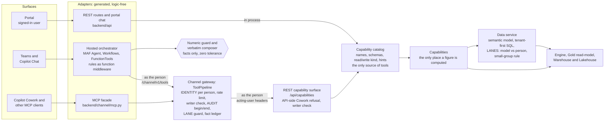

# One answer, everywhere

What was added so that the AI gateway and other AI clients can consume the platform's agents, and why. Customer-neutral. Everything
below was read from the repository on branch `feat/m365-channel` after the RM-25 merge (4 November 2026) and from the tests named; what
could not be checked offline is marked **unverified**. Nothing here is a statement about a live deployment unless it says so.

## 1. The idea, in one paragraph

A tax consultant, an account manager and a portal user ask the same question: *which of my clients is closest to qualifying?*, *what
would hiring ten people in this city do?*. The answer must be **the same figure whichever door the question comes in by**, and every
figure must be one the deterministic engine produced. So there is **one calculation and many adapters**: the *capability catalog*
(`backend/application/capabilities/`) is the only place a tool is named, described, given an input schema and marked read or write,
and the only place a figure is computed. The portal, Teams, Microsoft 365 Copilot Chat and Copilot Cowork are generated, logic-free
adapters over it. An adapter may translate a shape, forward the person's identity and enforce a policy; it may not compute, round,
rank, sum, default or reformat a number. A language model narrates the engine's figures and never produces one ([ADR-004](ADR-004-agentic-workflows.md),
[ADR-008](ADR-008-channel-numeric-integrity.md)).

Why this matters to the owner: a new AI client (another agent, a gateway, a different assistant) is an adapter, not a second
implementation of the tax logic. It gets the same figures, the same per-person audit and the same refusals for free, and a test fails
if it does not.

## 2. The surfaces and their adapters

| Surface | Who uses it | Adapter (where) | How the tools are defined | Identity |
| --- | --- | --- | --- | --- |
| **Portal** (web app) | Signed-in users | REST routes of the API (`backend/api/`, thin: parse, dispatch through the mediator, shape the response) and the portal chat (`backend/api/chat/`, server-sent events with an evidence stream) | Routes call queries and commands; chat pipelines call the same capabilities in process | The signed-in user (Easy Auth on the web app, bearer validation on the API) |
| **REST capability surface** | The gateway; any REST client | `GET /api/capabilities`, `POST /api/capabilities/{tool}` (`backend/api/capabilities.py`) | Generated from the catalog | An agent token must name its acting user on every request; a user token is the user |
| **Channel gateway** | Teams and Copilot Chat via the orchestrator; Cowork | `backend/channel/` (`ToolPipeline`, `routes.py`): `GET /channel/v1/tools`, `POST /channel/v1/tools/{tool}`, `POST /channel/v1/audit/narration`, downloads | Generated from the catalog; `offered_for_channel` filters | Two token shapes, never mixed: the agent's app token plus the acting user, or a delegated user token |
| **MCP facade** | Cowork and any other MCP client | `backend/channel/mcp.py` (`POST /mcp`, a hand-written Streamable HTTP subset) | `tools/list` is generated from the catalog; a prepare tool carries the preview sentence, a commit tool the commit sentence | The caller's delegated token; the session is bound to that person |
| **MAF FunctionTools** | Teams and Copilot Chat | `channel_orchestrator/app/core/maf_catalog_tools.py`: one factory builds a Microsoft Agent Framework `FunctionTool` per offered capability; the body only forwards through `GatewayClient` as the acting person | Name, description, schema and kind come from the catalog (`model_offered()`); no tool is defined by hand | The person the platform signals name, resolved once per request and carried in `function_invocation_kwargs` |

Two more pieces sit inside the orchestrator and are not surfaces:

- **Rules as MAF function middleware** (`maf_tool_rules.py`, `maf_tool_call.py`): the tool budget, the refusal of any `*_commit` tool,
  the client chosen from the reader's words rather than the model's, the year and method from the reader, the schema check, then the
  call, then fact capture. The model is shown fact *names*, never values.
- **MAF Workflows** for the two fixed sequences: the write path (prepare, then the framework's request step that waits for the
  person's exact `confirm`, then commit) and the client review pack (resolve the client, run the capabilities, check, compose). An
  Agent is used only for open questions ([pattern rules](../../backend/tests/test_architecture_patterns.py)).

The orchestrator then composes the reply **in code**: the narrator writes only `{{facts.…}}` placeholders, the composer substitutes the
engine's rendering, and a zero-tolerance numeric guard rejects any figure that is not a supplied fact ([ADR-008](ADR-008-channel-numeric-integrity.md)).
Cowork's own model writes its own text, so for documents authored there the gateway offers `verify_figures`.

## 3. How it fits together

Reading it: the portal reaches the capabilities in process through its own API; Teams and Copilot Chat go through the orchestrator,
which asks the gateway as the person; Cowork goes through the MCP facade to the same gateway. Identity, the per-user audit, the lane
guard and the ledger are in the gateway's one pipeline, the API checks the Cowork and writer rules again by itself (the gateway is not
the only door a token can use), and the numeric guard stands between the orchestrator's narrator and the reader.

## 4. What is behind a flag

Every new capability is off, or inert, until somebody turns it on. Defaults are read from `infra/variables.tf`, `infra/main.tfvars.json`
and [ENV-VARS.md](ENV-VARS.md).

| Flag | Default | What it switches | Notes |
| --- | --- | --- | --- |
| `enable_m365_channel` (azd `TCC_ENABLE_M365_CHANNEL`) | `false` | Creates the channel gateway: a third App Service on the existing plan, its identity, a telemetry role, a diagnostic setting | Public profile only; refused for `enterprise`; needs `auth_mode = entra` and an API client id. With it off the Terraform plan gains no resource (`channel.tftest.hcl`: `off_creates_nothing_and_says_so`) |
| `enable_mock_ai_gateway` | `false` | A mock OpenAI-compatible gateway App Service on the same plan, for a proof of concept | Refused for `enterprise`; deploying the script into it is a separate manual step |
| `DATA_QUERY_SOURCE_ENABLED` (`data_query_source_enabled`) | `false` | The raw-payroll (lakehouse source) datasets of the governed data query. The Gold and ops datasets are not behind it | Needs read-only grants on the lakehouse endpoint, added by postprovision only when this is `true` |
| `KNOWLEDGE_ENABLED` (+ `KNOWLEDGE_PROVIDER`) | `false` | The knowledge tier: cited reference text through a port, never a figure | Read by the orchestrator only; not set by Terraform or any profile (a test fails if one sets it). Only a fake source is built; the Foundry IQ adapter is designed, not built ([ADR-010](ADR-010-knowledge-tier.md)) |
| `CHANNEL_RESOLVE_DISPLAY_NAMES` (`channel_resolve_display_names`) | `false` | The gateway looks a Teams user's display name and UPN up in Microsoft Graph | Needs an admin-granted Graph role on the gateway identity; fails soft without it |
| `CHANNEL_DEBUG_WHOAMI` (`channel_debug_whoami`) | `false` | A diagnostic tool and the orchestrator's `/whoami`, `/netcheck`, `/modelprobe` | Demo and identity spikes only; logs a warning at startup when on; [DEMO-CLEANUP.md](../m365-channel/DEMO-CLEANUP.md) |
| `AUTH_MODE` | `entra` | API sign-in. `none` is allowed only with `ENVIRONMENT=local` set explicitly, or, for a deployed synthetic demo, `ALLOW_ANONYMOUS_SYNTHETIC=1` with `DATA_CLASSIFICATION=synthetic`; anything else refuses to start | The public profile's Terraform sets `AUTH_MODE=none` through the profile default and now also `ALLOW_ANONYMOUS_SYNTHETIC=1` (RM-03) |
| `CHANNEL_CALLER_CHANNELS` | unset | Binds each trusted agent caller to the channels it may assert | Unset keeps enum-level trust for every registered caller (the gateway warns at start); an owner decision, listed in the remediation Summary |
| `CHANNEL_MCP_ALLOWED_ORIGINS` | empty | Origins a browser-originated request to `/mcp` may carry | Empty admits none; **unverified** against the real Cowork client |
| `CHANNEL_WRITER_SOURCE` | `allowlist` | Who may make changes through the channel: `allowlist`, `entra_group` or `either` | Writers are people, never service principals |
| `DATA_MIN_GROUP_SIZE` | `5` (a value below 2 is read as 2) | The smallest group an aggregate over employee-level data may show; smaller groups are left out and counted | A privacy floor, so not mapped in Terraform; a writer is exempt |
| `AI_PROVIDER_CHAIN` | empty (the application default, `foundry`) | Which model providers narrate. Exactly `foundry` is served by the framework's own client; a chain that names `gateway` keeps the custom chain | The model never produces a figure under any chain |
| `foundry_public_network_access` (`TCC_FOUNDRY_PUBLIC_NETWORK_ACCESS`) | `false` | The demo network posture of the Foundry account | Refused for `enterprise` and for customer data; default is private, byte for byte |

## 5. What is unchanged against `main`

`main` is at `029b9ad2d2c002c09167375748120c7a8af3bc03` and has not moved. The comparison below is `git diff --stat main..HEAD -- infra/`
(19 files, +2,331 / −20 lines) plus a read of every shared file in it.

**The default `azd up` on the public profile plans the same Terraform resources as before.** The root module set is the eight modules
`main` has (identity, network, monitoring, storage, keyvault, foundry, fabric, app_service) plus two new ones that create nothing unless
asked (`mock_ai_gateway` and `channel`, both `count = 0` behind their flags). The app service module still declares the same six
resources (plan, API, web, web private endpoint, two diagnostic settings). The new files are the channel and mock-gateway modules, a
`foundry_network.tf` whose only resource has `count = 0` by default, five test files (about 1,200 lines) and outputs.

What a default `azd up` still creates is therefore: the resource group, the identities, the network and private DNS, Log Analytics and
Application Insights, storage, the Foundry account, project and model deployment, the Fabric workspace, lakehouse and warehouse (when
Terraform creates them), and the App Service plan with the API and the web app. Key Vault stays off (`enable_key_vault = false`).

What **does** differ for a default deployment, so nothing is a surprise:

- **One new API app setting**, `ALLOW_ANONYMOUS_SYNTHETIC=1`, emitted when `auth_mode = none` (the public profile). An in-place change
  to an existing app, not a resource. Without it the API now refuses to start with `AUTH_MODE=none` (RM-03).
- **New API code, no new endpoint reachable by default beyond three routes**: `GET /api/capabilities`, `POST /api/capabilities/{tool}`
  and `GET /api/audit/channel` (`backend/tests/route_inventory.json` records the addition). They sit behind the same sign-in mode as every
  other API route.
- **Two additive Warehouse migrations** that `apply-migrations.py` applies on provision whether or not the channel is on: three tables
  (`tcc_ops.channel_audit`, `channel_user`, `channel_confirmation`) and two nullable columns on `program_engagement`. The reference DDL
  (`tcc-schema.fabric.sql`) is unchanged. **Unverified on a fresh Warehouse:** read from the script and the migration files, not run in this session.
- **A `postdeploy` hook** (`scripts/deploy-channel.ps1`) that exits at once unless `TCC_ENABLE_M365_CHANNEL` is `true`.
- **The synthetic source load now runs only when Terraform created the Lakehouse** (`TCC_FABRIC_CREATED=true`). It overwrites every table
  it writes, so this is a narrowing of what `azd up` does to a Lakehouse the operator brought.
- Newer pinned SDKs in `backend/requirements.txt` (the agent framework, the Foundry SDK, `jsonschema`).

Everything else the new work needs is opt-in: the gateway, the mock gateway, the data query's source datasets, the knowledge tier, the
display-name lookup, the debug tools and Foundry's public posture. The Easy Auth change (Easy Auth on the web app when a web registration
id is supplied with `auth_mode = entra`) applies only when that id is set. The orchestrator is a separate azd project deployed with its
own `azd deploy`; a root `azd up` does not deploy it.

## 6. The proof: one question, five doors, identical figures

`backend/tests/channel_orchestrator/` holds the parity and conformance suite (RM-13, [D-135](../m365-channel/DECISIONS.md)).

| File | Cases | What it proves |
| --- | --- | --- |
| `test_parity_figures.py` (with `parity_cases.py`, `parity_compare.py`, `parity_rig.py`) | 72 | **19 questions × 5 doors on the real engine** (the synthetic payroll replayed into a SQLite Gold store; the real gateway in front of the real API; no model): reads, whole-book versus one client, scenarios, the data tools, a prepared write. 102 answers compared, **all identical**: 76 envelope comparisons (19 cases × REST on the API, REST through the gateway, MCP `tools/call`, the MAF `FunctionTool`), compared as canonical JSON byte for byte after masking six declared volatile fields (each justified in `parity_compare.py`); 19 whole Teams or Copilot Chat turns (the platform's blocks appear verbatim, no number the engine did not state); 7 portal chat cases (the evidence blocks equal the REST envelope, and every number a narrator is told is a capability fact). A prepared write changes nothing on any of the five doors |
| `test_parity_conformance.py` | 9 | The tool list, names, descriptions, schemas, kinds and hints are identical across the catalog, MCP `tools/list`, the MAF `FunctionTool` set, the gateway REST list and the API list; every declared difference is a literal in the test |
| `../test_architecture_adapters.py` | 6 | No adapter computes or formats a figure: a detector over the MCP facade, the gateway routes, the API capability route and the portal pipelines |
| `../channel/test_gw_mcp_conformance.py` | 89 | The facade is a standard MCP server (initialize, ping, `tools/list`, `tools/call`, unknown session, error codes), checked with the SDK's own client |

The checks fail when an adapter lies: three mutations (and a portal pipeline that adds its own figure) each failed the suite. One adapter
bug was found and fixed: the portal's discovery pipelines summed the hits' credits themselves; the sums are now `facts.totals` of the
capability. Related rules, each a failing test: nothing defines a tool outside the catalog (`test_architecture_catalog_only.py`), where
each MAF pattern may be used and that no executor or tool body computes a figure (`test_architecture_patterns.py`).

**What the proof does not cover** (REMEDIATION-FINDINGS F-22 to F-26): the portal's narration prose is still streamed unchecked
(it proves what the portal *shows* and what its narrators are *told*, not what a model then writes); twelve cases are declared not
applicable to the portal, each with its reason (four chat intents do not run the catalog tool the other doors run); the hosted
Responses/Activity handler, a real model in the Agent loop, Cowork's own client and the Fabric warehouse (SQLite stands in) were not
driven in process.

## 7. The hand-rolled inventory, final

Every custom component of the orchestrator and the gateway, with the outcome after the remediation run. This is a condensed copy of
the table in [MAF-ALIGNMENT.md](../m365-channel/MAF-ALIGNMENT.md#hand-rolled-inventory), where each row also carries the evidence and the
framework class. **REPLACED**: a framework primitive does the job. **WRAPPED**: the guarantee is kept, in a framework extension point.
**KEPT**: custom code stays, for the reason given. All 47 rows were re-checked against the code in RM-22; two found wrong in the
earlier text are said so (H5, and T5/T6, which were planned to move and did not).

Tally: REPLACED 5, WRAPPED 11, KEPT 28, and three rows that are a mix (P4 and G8 REPLACED for a foundry-only chain and KEPT otherwise;
P6 WRAPPED for egress and deadline and KEPT for provider failover).

| # | Component | Outcome | Why |
| --- | --- | --- | --- |
| H1 | Entry shell (`main.py`, `app/main.py`) | **KEPT** | The hosting package is pre-release only and has no Activity handler (NO-GO, D-128); the seam is a tested rule |
| H2 | Platform identity signals (`signals_of`, `conversation_of`, `who_is_asking`) | **KEPT** | No framework maps the platform's signals to an Entra object id and a refusal |
| H3 | Debug reports (`whoami`, `modelprobe`, `netcheck`) | **KEPT** | Diagnostics for this runtime's network and headers; no equivalent; off by default |
| H4 | Composition root (`app/wiring.py`) | **KEPT** | `Agent` has no composition root; tools and middleware are built per turn from the catalog |
| H5 | Environment to `OrchestratorSettings` | **KEPT** | Planned to move to typed `Settings` in RM-20; it did not (the orchestrator vendors its parsers and cannot import the backend's config, F-40). The framework's loader is private |
| H6 | Identity resolution (`resolve_identity`, `Refusal`) | **KEPT** | Attribution to a named person and refusal before any tool or model are this product's policy |
| H7 | Carrying the person into every tool call | **WRAPPED** | `function_invocation_kwargs` to `FunctionInvocationContext.kwargs`; tools and rules are built once and hold no state |
| H8 | Gateway client (`GatewayClient`) | **KEPT** | The typed REST door with the commit fields; it is the body of the generated tools |
| T1 | Turn pipeline (`TurnPipeline`) | **WRAPPED** | Stays the thin entry (identity gate, exact-word gate, deadline); writes and the review pack are Workflows |
| T2 | Exact-word confirmation (`parse_command`) | **KEPT** | A product rule about free text no framework approval models; it produces the typed reply the Workflow consumes |
| T3 | Commit (`commit_pending`) | **REPLACED** | A commit executor in the write Workflow, reached only through `Approved` |
| T4 | Pending write and its token | **REPLACED** | The Workflow's pending request and an in-memory checkpoint; the token is never persisted |
| T5 | Conversation pin (`client_id`, `tax_year`, candidates, question) | **KEPT** | Read before any Agent exists and on paths with no session; a second copy in provider state would be two sources of the pin |
| T6 | Bounded history for the client resolver | **KEPT** | Routing context for a deterministic resolver, not a transcript; the framework's history keeps full messages for a model |
| T7 | Per-person, per-conversation state store | **KEPT** | A replica-local TTL registry is the decided durability (D-81); the token must not reach a durable store |
| T8 | Narration audit (`NarrationAuditor`) | **KEPT** | No single framework hook sees both the model trace and the composed verdict across all paths |
| T9 | Fixed sentences and placeholder format | **KEPT** | Product copy and the narrator-brief format |
| R1 | Tool budget | **WRAPPED** | `Budget`, the first function middleware; the framework's limit is only a backstop |
| R2 | Unknown or commit tool refused and recorded | **WRAPPED** | A chat middleware records unregistered names (function middleware never sees them); the same rule in function middleware as defence in depth |
| R3 | Client chosen by code | **WRAPPED** | `ClientFromReader` writes the resolver's client over the model's |
| R4 | Year, method and scenario size from the reader | **WRAPPED** | `YearAndMethodFromReader` over pure helpers of the reader's words |
| R5 | Schema check against the catalog schema | **WRAPPED** | `SchemaCheck`; the framework's own check is shallow (F-04) |
| R6 | A repeated identical call returns the earlier answer | **WRAPPED** | `CallAndCapture` answers from the turn's record |
| R7 | Eligibility under both certified methods, labelled | **WRAPPED** | `CallAndCapture` calls once per method from the catalog's marking |
| R8 | Fact capture, token strip, hold the prepared write | **WRAPPED** | The envelope is captured after the call; the confirmation token is never in what the model reads |
| R9 | Names-not-values reply to the model | **WRAPPED** | The result is replaced with fact names through `context.result` |
| R10 | Lane projection for the model | **KEPT** | Employee rows must never reach a model (ADR-009); nothing in a framework can know a lane |
| R11 | One span per gateway call | **KEPT** | The span names and allowed attributes are a pinned contract; the keyword mode has no framework span |
| R12 | Hand-defined model-facing schemas | **REPLACED** | `maf_catalog_tools.py` generates every tool from the catalog |
| P1 | Tools-mode planner | **REPLACED** | The MAF `Agent` is the planner for open questions |
| P2 | JSON planner | **KEPT** | A model that cannot call tools cannot be an `Agent`; a degraded path behind one interface |
| P3 | Keyword planner | **KEPT** | Must answer with no model at all and cannot be talked into anything |
| P4 | Chat client over `ModelChain` | **REPLACED / KEPT** | The framework's OpenAI chat client serves a foundry-only chain; a chain that names a gateway keeps the custom client |
| P5 | `ComposeMiddleware` | **KEPT** | It is the framework primitive (`AgentMiddleware`); the Agent's only exit is the composer's reply |
| P6 | `ModelChain`, egress policy, injection screen | **WRAPPED / KEPT** | Egress and deadline are chat middleware on the framework path; failover across providers stays in `ModelChain` |
| P7 | Composer and numeric guard | **KEPT** | The exactness guarantee is platform code; the one path from a model's words to a reader |
| P8 | Prompts | **KEPT** | Content, passed through the framework; the knowledge provider is a `ContextProvider` that only adds instructions |
| G1 | `ToolPipeline` | **KEPT** | The audit boundary for every surface; it is not an agent |
| G2 | MCP facade (`mcp.py`) | **KEPT** | The SDK serves a second person on the first person's session and answers an unauthenticated call with HTTP 200; the session binding is code either way. Held to the standard by 89 conformance tests (D-136) |
| G3 | Caller authentication and channel binding | **KEPT** | Entra validation, `Channel.Invoke` and channel binding are product policy |
| G4 | Fact ledger and `verify_figures` | **KEPT** | A guarantee, not plumbing |
| G5 | Lane guard, limiter, people, narration, render, downloads | **KEPT** | Gateway guarantees and endpoints |
| G6 | Gateway HTTP shell and composition | **KEPT** | The gateway's own surface, held to the catalog by the adapter test |
| G7 | `channel_ping` defined by hand | **REPLACED** | Now `catalog.CHANNEL_PING`; the MCP facade's description edits are catalog functions |
| G8 | Shared safety, egress, OpenAI-compatible adapter, lanes | **REPLACED / KEPT** | The orchestrator drops its adapter for a foundry-only chain; the backend keeps it for the portal and for a gateway chain; lanes unchanged |
| G9 | `vendor-orchestrator.py` | **KEPT** | Packaging; unrelated to the framework |
| G10 | Specialist prompt-agent publishing | **KEPT** | Publishing unchanged (immutable versions); the declaration is centralised in `backend/agents/agents.json` (D-133) |

## 8. Where to read next

[ADR-009](ADR-009-m365-channel.md) (the channel), [ADR-008](ADR-008-channel-numeric-integrity.md) (numeric integrity),
[ADR-010](ADR-010-knowledge-tier.md) (knowledge), [MAF-ALIGNMENT.md](../m365-channel/MAF-ALIGNMENT.md) (versions, the API map, the
verdicts and the go/no-go), [DATA-ACCESS.md](../m365-channel/DATA-ACCESS.md) (the governed data tools and lanes),
[ORCHESTRATOR.md](../m365-channel/ORCHESTRATOR.md), and the remediation run's
[Summary](../m365-channel/REMEDIATION-FINDINGS.md) with the decisions it needs from the owner.
