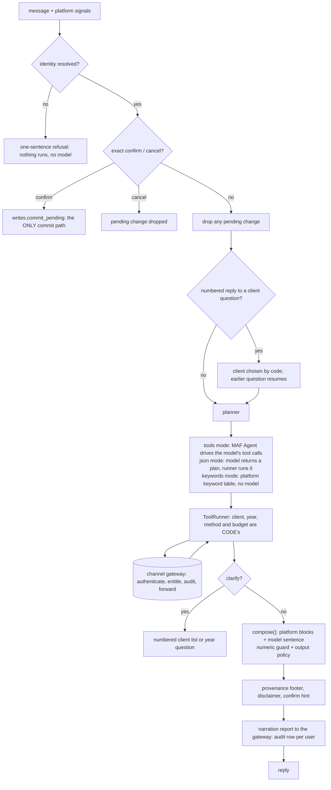

# The hosted orchestrator

`channel_orchestrator/` is a Foundry **hosted agent** that answers questions in Teams and
Microsoft 365 Copilot Chat. It holds no tax logic and no data: it decides which of the platform's
deterministic tools to run for the person asking, calls them through the channel gateway, and
returns the engine's own words around, at most, one verified sentence from a language model.

Every figure is the engine's. Every action is attributed to a named person.

## A turn



`TurnPipeline.handle` (`app/core/turn.py`) is that diagram. The pieces are in `app/core/`:
`identity`, `state`, `toolset`/`tools` (the runner), `planner`, `maf_agent`, `models`, `compose`,
`writes`, `replies`, `gateway_client`, `settings`; `app/host.py` and `app/main.py` are the hosting shell.

## What no model controls

| Decision | Who makes it | Where |
| --- | --- | --- |
| Who is asking | The platform's signals, or nobody | `identity.resolve_identity` |
| Whose client this is | The platform's deterministic resolver (`client_resolve`; the channel settles one exact full name or alias as `resolved: true`, while partial or ambiguous text still asks and the portal chat stays strict). The model's `client_id` is overwritten | `tools.ToolRunner.ensure_client` |
| Which tax year | The reader's words, or the conversation's, or a question back. A year the model names is used only if the reader said it. A write never inherits one | `tools.ToolRunner._year` |
| Which method | The reader's. Eligibility runs under **both** certified methods unless one is named, each labelled | `tools._method`, `compose.blocks_of` |
| A what-if's size, a base year | The reader's. A number or year the model chose is dropped; a missing size or base year is a question back | `tools._scenario`, `tools._years` |
| Any figure | The tools' facts, rendered by the platform's formatter | `composer.compose` |
| Whether a model sentence survives | The numeric guard and output policy, on the model's raw words and on the finished reply | `composer.compose` |
| How many tools run, how long a turn takes | `CHANNEL_MAX_TOOL_CALLS`, `CHANNEL_TURN_TIMEOUT_SECONDS` | `tools.ToolRunner.run`, `turn.TurnPipeline` |
| Whether a change is made | The same person, typing `confirm`, within `CHANNEL_CONFIRM_TTL_SECONDS` | `writes.commit_pending` |

What the model sees of a tool result is the **names** of the facts (`narrator_brief`), never their
values, so it cannot copy a figure as a digit. It writes `{{facts.path|format}}` placeholders and the
formatter substitutes the engine's rendering. The prepared change's confirmation token is removed from
the facts before anyone, model included, sees them.

## Identity

The gateway needs the person's Entra object id, name and tenant (`X-Acting-*`). Where the orchestrator
gets them is **not settled for the Teams path**: the Foundry runtime documents an opaque per-user id
(`x-agent-user-id`), an experimental original-subject assertion (`x-ms-original-subject`: `oid`, `tid`,
`idtype`, described as attribution, not proof) and, only when end-user delegation is authorised, a
trusted `x-ms-user-identity`. `CHANNEL_IDENTITY_SOURCES` chooses, in order:

| Source | Signal | Assurance | Default |
| --- | --- | --- | --- |
| `original-subject` | `x-ms-original-subject` (oid, tid) | the platform asserts it; the gateway records `channel-asserted` | on |
| `platform` | `x-ms-user-identity` | the platform's trusted resolved user | on |
| `client-headers` | `x-client-acting-user-*` | **caller-supplied**: anyone who can call the agent can claim anyone | off |

`x-agent-user-id` is not a source: it is not an object id, the gateway would refuse it, and mapping it
to one would assert an identity nobody proved. With nothing resolvable the turn says so in one sentence
and runs **nothing**: no tool, no model. The resolution records which source answered; `/whoami` (only
with `CHANNEL_DEBUG_WHOAMI`) reports the signals received so the live spike can settle it.

Whatever the source, the gateway records the assurance as `channel-asserted`: the person did not
present a token of their own. That is stated in the audit row, not inferred.

## Confirming a change

A model may only **prepare**. The preview is shown with *Reply **confirm** to apply this change, or
**cancel** to drop it.* The token stays in the orchestrator's memory and never in text. Then:

- **exact words only**: `confirm`, `yes, apply`, `cancel` (case and trailing punctuation ignored);
  "please go ahead" is a new question;
- **per person and conversation**: somebody else's `confirm` finds nothing, and is told so;
- **any other message** drops the pending change, and the reply to that message says so ("The change I
  previewed earlier was dropped; nothing was changed");
- **expiry**: after `CHANNEL_CONFIRM_TTL_SECONDS` the preview is refused with a fresh-preview hint;
- **the pending change is cleared before the commit is sent**, with a fresh idempotency key, and a
  commit is **never retried** by the orchestrator. If the answer is lost the person is told the outcome is
  unknown and to check the record. The gateway and API check the token, user, tool, arguments, expiry and
  single use again, and the writer entitlement again.

`*_commit` is not a tool a model can name: `tools.model_tools()` excludes it, no MAF tool is registered
for it, an attempt is refused and recorded (`TurnReply.refused`), and `test_orch_structure.py` fails the
build if a commit name or `commit_pending` call appears outside `writes.py` / `turn.py`.

## When the guard rejects the narration

The reply is the platform's blocks and the standing disclaimer, then a line saying the commentary was
withheld because it could not be verified, then the provenance footer. The narration is dropped **whole**
(never patched), the guard status is `rejected`, and the report filed with the gateway says so and how
many figures failed. A model that is down gets the same reply with a line saying so.

Besides a bad digit, an unresolvable placeholder or a policy break, a narration is dropped when an approximation qualifier ("about", "roughly", "rounded", "up to"...) sits within three tokens of a figure (`composer_hedging`, CH-15c): every figure shown is exact, and "not rounded" is rejected as well.

## Narration and planning quality (CH-15c)

The narrator prompt (`backend/agents/prompts/channel_narrator.md`, vendored unchanged, version 3) asks for a senior colleague's voice: one to four sentences, the answer first, the engine's own labels, no rank prose, no hedging, the exact `placeholder` copied from `fact_paths`, and twelve worked examples (six added in CH-16e for data results). The planner's instructions and the tools' descriptions are the model's only guide to choosing a tool: `book_rank` says it is for the whole book only and every client tool begins "ONE client (needs a client)". Which client is still code (`ToolRunner.ensure_client`, run before any client tool). `golden/planning.json` and `test_orch_planning.py` pin the sequences and the wording; `tests/ai_evals` carries the routing and narration items. See [D-109](DECISIONS.md).

## Using the data tools (CH-16e)

The planner's instructions carry one decision rule, and the descriptions of `data_catalog`, `data_query` and `data_distinct_values` say the same thing, so a model reads it twice:

1. The **fixed engine tools** (`client_eligibility`, `client_trend`, `client_at_risk`, `client_discovery`, `simulate`) come first for the credit, eligibility, a trend, jobs at risk and a what-if. They are authoritative.
2. For a **descriptive or comparative** question about payroll or enriched data (an average, a count or a total by location, month, year, designation or method), `data_catalog` then `data_query`. A "why" question takes the fixed tool first and the data second: the data shows when a figure moved, not why.
3. `data_distinct_values` turns a name the reader gave into the value the data holds, before a filter.
4. **Never an invented column.** A catalog search with no match now says the data has nothing for it; say so and stop.
5. Name every measure with `as`; the narration refers to a result column by it. Prefer an aggregate to a list; a result is capped and says so.
6. The client is the one in the conversation; another client, or several, is a question back (`client_resolve`), never a data query.

Tool mode follows this naturally (the model reads the catalog result, then plans the query). **JSON mode** (`AI_GATEWAY_SUPPORTS_TOOLS=false`) has no tool loop, so a plan made only of lookup tools is run and the model is shown their results (the same lane projection) and asked once more; a plan that already holds a query is unchanged, and there is never a third planning call. What a model is shown never includes a person-level value: employee-level rows go to the reader and are dropped from `model_facts` ([ADR-009](../architecture/ADR-009-m365-channel.md)).

The narrator (prompt version 3) describes a data result by placeholder, says when it was capped (the limit by placeholder), says plainly when no rows matched or the data has no column for the question, never interprets ("unusual", "explains"), and never describes rows that went to the reader alone. `golden/data_use.json` (29 conversations), the `data_routing` AI eval (34 plans) and `test_data_equivalence.py` (the generic query equals the fixed tools on the real engine's Gold output) hold all of it; see [D-115](DECISIONS.md).

## Audit

The gateway audits every tool call itself (reads) or the API does (writes). The orchestrator adds the
one thing neither can see: that a model took part. After a turn in which a model was called it posts
`{agent_name, agent_version, model, prompt_sha256, tool_names, guard_status, violations_count,
output_summary}` to `POST /channel/v1/audit/narration`. The gateway writes a `channel_audit` event
(`action_kind='narrate'`, `numeric_guard` = the verdict) and a `tcc_ops.agent_action_audit` row whose
`is_deterministic_path` is true only when the guard passed. The prompt is represented by its hash, the
reply by its length. If filing fails the answer still goes out; the failure is logged and counted
(`/whoami` shows the count).

## Models

The orchestrator reads the same `AI_*` settings as the API and builds the shared
`OpenAICompatibleChatModel` for each provider in the chain (`foundry`: the agent's own Foundry account
over its Azure OpenAI v1 surface, with the agent's identity; `gateway`: the customer's). It does not use
`NarrationService`, because that path drops a model's tool calls by design and the orchestrator needs
them; it keeps the rest of the contract: the chain's rule (fall to the next provider only when one fails,
never splice two models' sentences, and stay with one provider through a tool loop), the egress policy
(an identifier never leaves; `aggregates_only` and `block` apply to external providers) and the injection
screen (a flagged message reaches no model and is answered by the keyword table).

Three planning modes, one outcome: **tools** (a provider offers tool calling: MAF `Agent` + `FunctionTool`s
from the catalog, with a middleware that replaces the model's text with the composer's), **json**
(`AI_GATEWAY_SUPPORTS_TOOLS=false`: the model returns `{"tools": [...]}`, validated and run by the runner,
then a second call narrates) and **keywords** (no model, or the model failed: the platform's own keyword
table). Invented tool names are never run.

Not carried over from the API's stack, and why: the token budget, breaker, bulkhead and retry wrappers
(`ai_wiring._decorate`) wrap `AgentRuntime`, which has no tool calls; here a call has a timeout
(`AI_TOTAL_DEADLINE_SECONDS`) and the chain's fallback. A shared budget is the follow-up if a customer needs it.

## Claim packages

"Send me the claim package for <client> <year>" is a write like any other: the model prepares
`claim_package_create`, the person confirms, the code commits, and then the **code** (not the model) asks the
gateway for `claim_package_link` and shows that link. A storage URL is never shown. If the package was built but
the link could not be had, the reply says so after "Done."

## Limits and failures

A turn has a deadline (`CHANNEL_TURN_TIMEOUT_SECONDS`, default 90). A gateway call that fails is a plain sentence
(`replies.py`): unreachable or timed out ("did not answer, nothing has been changed"), rate limited, the gateway
refusing the orchestrator's credentials, or the platform's own message for a refusal such as an unauthored tax
year. No status code, error code or stack trace reaches the reader. Conversation state is an in-memory dictionary
with a time to live, per replica: the runtime's session storage is a filesystem the platform may discard, and a
lost state costs a repeated question, never a wrong answer or a silent write (D-81).

## Telemetry

One span per gateway call (`tcc.tool.<name>`) through the hosting adapter's OpenTelemetry provider, carrying the
tool, its kind, the channel, the correlation id and the outcome. Never an argument, a fact, a client name, a figure
or a message (`test_orch_resilience.py` asserts this).

## Text, not cards

Published agents cannot stream, and no adaptive-card or attachment path through the hosted Responses runtime
was found in the documentation, so replies are Markdown text: the platform's blocks as headings, tables and
callouts. `composer.cards_payload` exists for a later card path; nothing here uses it. File uploads do not
work in Microsoft 365 Copilot (they do in Teams), so the claim package is offered as a gateway link.

## Run it offline

```pwsh
python scripts/vendor-orchestrator.py                 # copy the shared modules in (idempotent; --check verifies)
cd backend; ..\.venv\Scripts\python.exe -m pytest tests/channel_orchestrator -q
```

The tests run the real pipeline, MAF agent, tool runner, composer and guard against a fake gateway (an ASGI
app serving envelopes built with the platform's own block helpers), a scripted model, the mock model gateway
(`scripts/mock-ai-gateway.py`) for the wire, and, in `test_orch_e2e.py`, the real gateway and API.

To run the host itself against the mock gateway, export the variables in
[ENV-VARS.md](../architecture/ENV-VARS.md) section 9b with `AI_GATEWAY_AUTH=none` and
`pip install -r channel_orchestrator/requirements.txt`, then `python channel_orchestrator/main.py` and
`POST http://localhost:8088/responses {"input": "..."}`. A local request carries no platform headers, so set
`CHANNEL_IDENTITY_SOURCES=client-headers` and send `x-client-acting-user-oid` to be someone.

## Deploying

Recommended: the **source-code (zip) path**: `python scripts/vendor-orchestrator.py`, then `azd up` in
`channel_orchestrator/` (`azure.yaml`, `codeConfiguration`, `remote_build`). It needs no container registry
and Terraform adds none. A `Dockerfile` is kept for a local build and for the container path. See
[PUBLISHING.md](PUBLISHING.md) for putting the agent in Teams and Copilot, and D-74 to D-85 in
[DECISIONS.md](DECISIONS.md) for the choices and the facts they rest on.

Vendored code is not committed (`channel_orchestrator/app/vendor/` is gitignored): the script copies it
verbatim from `backend/` and records a SHA-256 manifest, and `test_orch_vendor.py` proves the copy matches,
that the closure stays inside the allowed layers, and that the copy runs without `backend/` on the path.

## Open for the live sandbox (Prompt 6)

1. Which identity signal a Teams and a Copilot Chat message actually carries (for a direct caller, `x-agent-user-id` is the object id), and whether it is the Entra
   object id (spike S3). Until then the default sources fail closed.
2. Whether a hosted agent in a network-isolated project can reach the gateway and the model endpoint. **Per
   the Foundry documentation, unproven until spike S6** ([HARDENING-SPIKE](HARDENING-SPIKE.md)): the hosted-agent
   path uses a customer-delegated agent subnet and private endpoints, with no Cosmos DB, AI Search or capability
   host. The "standard agent setup" this note once named is the classic path that needs them, and the customer
   has ruled Cosmos out (D-92). For the demo the Foundry data plane is opened by one toggle instead
   ([HARDENING-PLAN](../architecture/HARDENING-PLAN.md) §2).
3. Whether the Activity-to-Responses bridge carries the sender's display name (without it the audit row says
   `(name not provided)`; the object id is still recorded).
4. Whether `azd ai agent` accepts `channel_orchestrator/azure.yaml` as written, and the hosted-agent region
   for the sandbox.

## Live findings (CH-14, 3 November 2026)

- **Teams reaches the container through the Responses bridge.** `azure.yaml` declares `activity` on the **endpoint** only
  (`agentEndpoint.protocols`), never under the container's `protocols:`: this container serves Responses, and a container that
  declares `activity` is sent Teams messages at `/activity/messages` (a 404 here). Authorization schemes `Entra` and `BotServiceRbac`.
  After every `azd deploy` or publish, `GET /agents/<name>` and check `definition.protocol_versions` is `responses` only ([D-100](DECISIONS.md)).
- **The model is reached on `<account>.openai.azure.com`**, not the project's own host, which the hosted runtime cannot resolve ([D-101](DECISIONS.md)).
  The agent's instance identity needs **Foundry User** and **Cognitive Services User** on the account.
- **Diagnostics, with `CHANNEL_DEBUG_WHOAMI`:** `/whoami` (identity signals, and the *shape* of `x-agent-user-id`), `/netcheck` (name resolution, TCP, TLS and
  an unauthenticated HTTP status for the project and account hosts, the gateway, the login host and a public control; names of environment variables, never a value
  beyond a short allow-list) and `/modelprobe` (the model call exactly as Microsoft's `bring-your-own/responses/hello-world` sample makes it). None returns a token.
- **Identity.** `x-agent-user-id` is a default source (`agent-user-id`), used only when it is a GUID; for a caller's own token it equalled the caller's object id.
- **What a model needs to be handed.** Every `fact_paths` entry carries its exact `placeholder` (`{{facts.<path>|<format>}}`); without it a model dropped `facts.` and the
  whole narration was withheld by the guard.
- **A hosted orchestrator can use a customer gateway only if that gateway is reachable from the hosted runtime's network.** The mock is not (subnet-only), so the chain is `foundry`.
