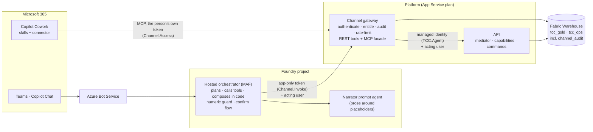
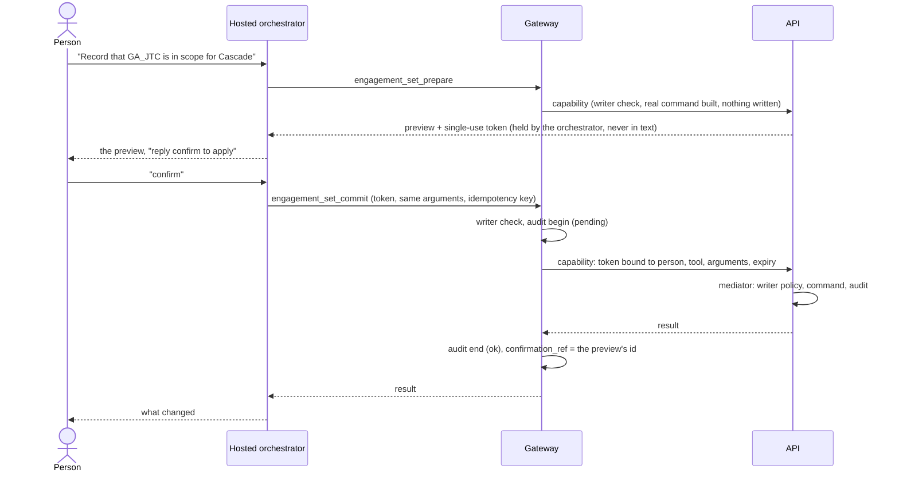

# Microsoft 365 channel

Tax consultants and account teams can use Tax Credit Copilot from **Teams**, **Microsoft 365
Copilot Chat** and **Copilot Cowork** without opening the web app. The promise is narrow and
checkable: **every figure shown is the engine's figure, and every action is attributed to a named
person.** Nothing here computes a number, decides who may do what, or changes a record without a
confirmation. It is a new way in; the engine, the rules and the data are the ones the portal uses.

Customer-neutral and PoC-grade: the first deployment runs on synthetic data, with the limits in
[KNOWN-LIMITATIONS.md](KNOWN-LIMITATIONS.md) and the posture in [SECURITY.md](../../SECURITY.md).

## Architecture



| Piece | What it is | What it does not do |
| --- | --- | --- |
| **Capabilities** (`backend/application/capabilities/`) | The tool catalog: plain functions returning an envelope of `facts`, platform-rendered `blocks`, `provenance` and the disclaimer. The portal chat and the channel call the same ones | Know about HTTP, Teams or any model |
| **API** | The one authority for calculation, claims and findings. `POST /api/capabilities/{tool}` runs a capability; writes go through the mediator, behind the writer policy | Learn anything about Copilot |
| **Channel gateway** (`backend/channel/`) | Authenticates every call (an agent token with `Channel.Invoke`, or a person's token with `Channel.Access`), applies the writer check, rate-limits, writes the per-user audit, keeps the conversation's fact ledger, serves REST and MCP, issues single-use download tickets | Hold a business rule |
| **Hosted orchestrator** (`channel_orchestrator/`) | Reads the message, resolves identity, picks tools, **assembles the reply in code**, runs the confirm flow | Compute or rephrase a figure |
| **Narrator** | At most one verified sentence around placeholders; never shown a value | See a number or call a tool |
| **Cowork plugin** (`channels/cowork/`) | Skills for two workflows and a connector to the gateway's `/mcp` | Guarantee wording (see below) |

## Who can do what

| | Reader | Writer |
| --- | --- | --- |
| Rank the book, read a client's situation, eligibility, trend, jobs at risk, other programmes, findings, what-ifs, the calculation walkthrough | Yes | Yes |
| Fetch a claim package link | Yes | Yes |
| Check a draft's figures (`verify_figures`) | Yes | Yes |
| Preview or commit a change (resolve a finding, move a claim, set engagement, set a base year, record a claim, build a package) | **No.** Refused at the gateway and again at the API, and audited as `refused` | Yes, in two steps, each confirmed |

A **writer** is on the allow-list (`scripts/channel-writers.py`, `CHANNEL_WRITER_SOURCE=allowlist`) or
in the configured Entra group. Everyone else who can sign in is a reader. There is no administrator
tool in the channel: managing writers, running a calculation, applying a rule pack and the ingestion
queue stay in the portal and the operator's scripts.

## Data flow: a question

```mermaid
sequenceDiagram
    actor P as Person
    participant H as Hosted orchestrator
    participant G as Gateway
    participant A as API
    participant W as Warehouse
    P->>H: "Who should we call this week?"
    H->>H: identity from the platform's signals (nothing runs without one)
    H->>G: book_rank — app-only token, X-Acting-User
    G->>G: authenticate, rate-limit, audit begin
    G->>A: capability call — managed-identity token, acting user
    A->>W: read recorded claims (no engine run)
    A-->>G: envelope: facts + blocks + provenance
    G->>G: record facts in the conversation ledger, audit end
    G-->>H: envelope
    H->>H: compose: blocks + one narrator sentence; numeric guard on both
    H-->>P: reply with the disclaimer
```

If the guard rejects the sentence, the person gets the engine's blocks and a note that the
commentary was withheld. If the model is down, the same.

## Data flow: a change



A retried commit with the same key replays the first outcome and writes once. A token works once, for
one person and one set of arguments, before it expires. A model cannot name a commit tool.

## The audit model

Every tool call is a row pair in `tcc_ops.channel_audit` (`begin`, `end`; a refusal before dispatch is
a single row). Per row: who (`user_oid`, tenant, name), how strongly they were identified, on which
channel, which tool, which client and year, a hash of the arguments (never the content), the outcome,
and for a commit the id of the preview it confirmed (`confirmation_ref`).

| Field | Values | Meaning |
| --- | --- | --- |
| `channel` | `teams`, `m365-copilot`, `cowork` | The surface the person used |
| `identity_assurance` | `channel-asserted` | The orchestrator (holding `Channel.Invoke`) says this person is asking. Trusted because the caller is authenticated and the tenant matches. **Weaker than a token of the person's own** |
| | `delegated` | The person's own Entra token (Cowork). The gateway verified it |
| `action_kind` | `read`, `write_prepare`, `write_commit`, `narrate` | |
| `outcome` | `pending`, `ok`, `error`, `refused` | `pending` with no `end` is a crash or a call still running |
| `numeric_guard` | `pass`, `rejected`, `n/a` | For narration and `verify_figures` |

Read it with `GET /api/audit/channel?user_oid=` (a signed-in operator) or
`python scripts/channel-audit.py --user <oid>`. The orchestrator also files a record of each model
turn (`tcc_ops.agent_action_audit`). An action the platform cannot account for is not performed: if the
opening audit row cannot be written, the call is refused (`audit_unavailable`).

## What the orchestrator controls, and what Cowork's model controls

| | Teams and Copilot Chat (hosted orchestrator) | Cowork (skills and MCP) |
| --- | --- | --- |
| Who composes the reply | **Code**, from the platform's blocks | **Cowork's own model**, instructed by the skills |
| A figure | Rendered by the platform's formatter; a model sentence carrying a digit it was not given is dropped whole | Quoted from the tool's text if the model complies; **checked afterwards** by `verify_figures` |
| Whether a change is made | The person's exact word `confirm`; no commit tool is visible to a model | The skill's rule, the two-step tools, and Cowork's own prompt on the commit tool (`destructiveHint`) |
| Identity | Channel-asserted | Delegated token |
| What it guarantees | A wrong figure cannot reach the reader | A wrong figure is **caught if the author checks**, and the skills say to |

Say that table out loud in any demo. The difference is deliberate: Cowork authors documents, which
the orchestrator does not, and a model that writes a Word briefing cannot be assembled in code.

## Where to read next

| | |
| --- | --- |
| [ADR-008](../architecture/ADR-008-channel-numeric-integrity.md) | The numeric guard, the composer, `verify_figures`: as built |
| [ADR-009](../architecture/ADR-009-m365-channel.md) | Why Bot Service and a hosted orchestrator, the alternatives, the risks |
| [ORCHESTRATOR.md](ORCHESTRATOR.md) · [PUBLISHING.md](PUBLISHING.md) | The hosted agent; putting it in Teams and Copilot |
| [COWORK-SETUP.md](COWORK-SETUP.md) · [`channels/cowork/`](../../channels/cowork/README.md) | The plugin and how to install it |
| [DEMO-SCRIPT.md](DEMO-SCRIPT.md) | A demo and the manual test checklist |
| [KNOWN-LIMITATIONS.md](KNOWN-LIMITATIONS.md) | What it does not do |
| [DEMO-CLEANUP.md](DEMO-CLEANUP.md) | What to switch off after a demo, with the commands |
| [RUNBOOK §13](../architecture/RUNBOOK.md) · [CONNECTIVITY-MATRIX §1a](../architecture/CONNECTIVITY-MATRIX.md) | Operating it; who calls what |
| [HARDENING-PLAN](../architecture/HARDENING-PLAN.md) · [HARDENING-SPIKE](HARDENING-SPIKE.md) | The demo posture and the later private one |
| [DECISIONS.md](DECISIONS.md) · [STATUS.md](STATUS.md) | Every decision, and what is done |
